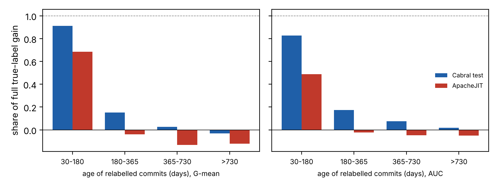

# Where does verification latency hurt online just-in-time defect prediction? A label-noise decomposition on 23 projects

**Authors:** [to be completed by the authors]
**Affiliations:** [to be completed by the authors]
**Corresponding author:** [to be completed by the authors]

## Abstract

Online just-in-time software defect prediction (JIT-SDP) retrains while recent labels are still unknown: a defect is found only when a later fix points back to it, a median of 16–568 days later in our data. The usual remedy, waiting W days before trusting a "clean" label, is read as a trade-off between label noise and stale data. We measure how much of the resulting loss comes from wrong labels and how much from missing recent data, which commits carry the harmful labels, and whether practical corrections recover the loss. We simulate prequential training with one shared learner on 23 projects (331,937 commits; 14 from Cabral et al., 9 from ApacheJIT as fresh confirmation) and analyse a 2×2 factorial design (labels observed or true × window waited or complete). The two causes interact: recent commits help only once their labels are correct. For a 30-day wait, true labels on the same training commits close 0.81 (Cabral test) and 0.92 (ApacheJIT) of the AUC gap to an oracle; for the tuned 90-day wait, 0.44 and 0.78, while a Shapley split attributes 0.74 and 0.97 of the gap to labels. Per false-clean label, the most recent waited-out commits do two to three times their share of the harm. Age-only corrections, feature-based denoisers and a latency-aware threshold did not significantly beat a 90-day wait on the fresh data. Methods should target recent defects that are still undiscovered.

**Keywords:** just-in-time defect prediction; verification latency; label noise; online learning; data streams; empirical software engineering

---

## 1 Introduction

Just-in-time software defect prediction (JIT-SDP) helps teams decide which incoming commits deserve careful review (Kamei et al. 2013). In an online deployment the model is retrained as the project evolves (Tan et al. 2015; Cabral et al. 2019; Tabassum et al. 2023; Cabral et al. 2023). This exposes a problem that offline studies hide: a commit's label is not available when the commit is made. A defect it introduces is discovered only when a later bug-fixing commit is traced back to it, typically with SZZ.

In the projects studied here, discovery takes a median of 16 to 568 days per project, and the 90th percentile ranges from 383 to 2811 days (Fig. 1, Section 4.1). At any moment the most recent "clean" commits are therefore only *provisionally* clean. Fix-inducing changes are a moving target over time (McIntosh & Kamei 2018), and ignoring time order inflates offline estimates (Falessi et al. 2020).

The established remedy is to wait: Tan et al. (2015) introduced a labelling gap for online defect prediction, and the *waiting-time* rule of Cabral et al. (2019) uses a commit as a clean training example only after W days without a discovered defect, while defective commits enter as soon as their defect is found. Later work treats the choice of W as a trade-off between label noise and staleness and studies how to evaluate under it (Cabral & Minku 2023; Song et al. 2023a; Song & Minku 2023). Other work estimates the confidence of waited-out clean labels (ODaSC; Song et al. 2022) or brings in human labels (Song et al. 2023b). Recent journal papers on JIT-SDP, including MSTDP in this journal (Liu et al. 2026), evaluate offline with final labels and do not model verification latency.

Our own starting point was a method. Borrowing the delayed-feedback model of conversion-rate prediction (Chapelle 2014), we weighted each provisionally clean commit by the posterior probability that it hides an undiscovered defect, given its age. **It did not work.** On the ten held-out projects it lost to a tuned 90-day wait by 0.038 G-mean (Section 5.3).

Diagnosing that failure changed the question. We first expected label noise to be a *small* part of the penalty, because waiting barely changes the share of false-clean labels (Section 5.1). We wrote down the hypothesis that true labels would recover less than a third of the gap between waiting and an oracle. **The hypothesis was refuted** (Section 5.2). This paper reports the resulting decomposition as an empirical study.

**Contributions.**
1. **A factorial decomposition of the online verification-latency penalty into label noise and lost freshness**, replicated on two dataset families (Section 5.2). Its main finding is that the two causes are entangled: the commits a wait excludes are the ones whose labels are wrong, and they become valuable only once their labels are right. For a 30-day wait the penalty is almost entirely label noise in AUC on both families; for the tuned 90-day wait the attribution depends on how the interaction is split. True-label comparisons have been made before, in the online setting by Song et al. (2022) and offline by Falessi et al. (2022) and Fan et al. (2021); the separation of noise from freshness is new.
2. **Localisation of the harmful labels** (Section 5.2). On both families and at both waits, the most recent waited-out commits do two to three times as much harm per false-clean label as the average. Older false-clean labels contribute little on Cabral and more on ApacheJIT, mostly jointly with the recent ones.
3. **Evidence that age-only corrections cannot recover the penalty**, with a diagnosis (Section 5.3).
4. **A fresh-data test of feature-based denoisers and of a latency-aware decision threshold** (Sections 5.4–5.5). On fresh data none reliably beats a tuned 90-day wait. One ODaSC-style adaptation beats it on the reused Cabral test set, and a threshold result obtained on that set did not replicate.

The protocol, the complete history of configurations run on the reused test set (Supplementary Table S3) and the deviations from plan (Section 7) are released with the paper, so that method papers can measure themselves against the true-label bound.

Table 1 defines the terms used throughout.

**Table 1.** Terminology.

| Term | Meaning here |
|:--|:--|
| Verification latency | Time between a commit and the moment its defect label becomes known (first linked fix). |
| Provisionally clean | A commit with no discovered defect *yet*. |
| False-clean | Provisionally clean but defect-inducing according to the final labels. |
| Wait-W | Clean labels are trusted only after W days (Tan et al. 2015; Cabral et al. 2019). |
| Prequential | Each commit is predicted on arrival, then used for training once its label is available. |
| SZZ | Algorithm that links bug-fixing commits back to the commits that introduced the bug. |
| L1 / L2 | Decomposition levels: L1 = the Wait-W training set with true labels; L2 = L1 plus young, not-yet-discovered defective commits. |
| Label / freshness effect | Shapley contributions of true labels and of adding the recent (not waited-out) commits to the gap between Wait-W and the oracle. |
| Right truncation | A defect's delay is observed only if it is discovered before the observation time. |
| θ, δ, k | Confidence threshold and neighbourhood size of the ODaSC-style rules (θ and δ name the same threshold in the two implementations). |

## 2 Background and related work

### 2.1 Online JIT-SDP and verification latency

JIT-SDP predicts whether a commit induces a defect from change metrics such as size, diffusion, history and developer experience (Kamei et al. 2013). Labels are usually produced by SZZ. SZZ itself introduces errors (Fan et al. 2021; Rosa et al. 2021; Herbold et al. 2022; Guo et al. 2024; Bludau & Pretschner 2026), and label noise in general harms defect models (Kim et al. 2011; Tantithamthavorn et al. 2015; Liu et al. 2023).

Online JIT-SDP evaluates prequentially (Tan et al. 2015; Cabral et al. 2019; Tabassum et al. 2023; Cabral et al. 2023; Sahar et al. 2024). Cabral et al. (2019) introduced the waiting-time rule together with ORB, an online bagging scheme for class-imbalance evolution. Cabral & Minku (2023) showed that concept drift combined with verification latency impairs the stability of online JIT-SDP, and proposed an approach for more stable predictive performance. Song & Minku (2023) proposed a procedure that evaluates JIT-SDP models continuously during development, and showed that waiting-time label noise affects the validity of such continuous evaluation. Song et al. (2023a) then asked whether the same noise threatens the retrospective evaluation used in research studies. On 13 GitHub projects they found that the choice of waiting time had no significant impact on validity and that even short waits gave high validity. Song et al. (2023b) proposed human labelling to shorten the wait, and Liu et al. (2025) revisited that approach under practical conditions, finding that human feedback improves online JIT-SDP by providing training commits with better label quality.

The finding of Song et al. (2023a) concerns *evaluation*: whether scores computed against waited-out labels rank models correctly. Our study concerns *training*: how much the model itself loses by learning from waited-out labels. The two are compatible. Evaluation labels in our design are final labels, so the evaluation is not affected by waiting at all, and a noise level that leaves the ranking of evaluated models unchanged can still change what a model learns.

For data streams in general, delayed labels have been studied as a drift-detection problem (Zliobaite 2010), with infinitely delayed labels (Souza et al. 2015), for temporally evolving streams (Plasse & Adams 2016), as an evaluation problem (Grzenda et al. 2020) and in a recent survey (Gomes et al. 2023).

### 2.2 One-sided label noise and dormant defects

A defect discovered after the wait leaves a wrongly clean example behind, so the noise is one-sided. ODaSC (Song et al. 2022) is the closest prior work. It estimates the confidence of each waited-out clean label from the class composition of feature-space micro-clusters and uses that confidence to modulate the oversampling rate of an online bagging ensemble of Hoeffding trees. Song et al. (2022) also ran two true-label benchmarks in the same online waiting setting: ODaSC-opt, which uses the optimal label confidence (one if the observed label is correct, zero otherwise), and ODaSC-flt, which removes the false-clean examples. On the first 10,000 commits of 14 projects with a 15-day wait, both benchmarks were statistically indistinguishable from ODaSC with estimated confidences (p = 0.7278 and 0.6932), and ODaSC beat online bagging trained on observed labels. This is the closest precedent for our L1 condition. It differs in three ways: it reweights or filters the noisy examples rather than relabelling them as defective, it uses one short wait, and it does not separate noise from freshness. We return to the difference in effect size in Section 6.2.

On release-level data, Ahluwalia et al. (2019) and Falessi et al. (2022) showed that classes whose defects are still dormant ("snoring") lower prediction accuracy. Falessi et al. (2022) compared models trained on dormant-noisy and on clean labels. As a countermeasure they removed the classes labelled non-defective in the last releases while keeping the defective ones, which is the release-level counterpart of Wait-W. Removing one release helped, but the gain was particularly small in AUC, and removing more than one release reduced precision. Vandehei et al. (2021) used the defect life cycle to label affected versions, and Chen et al. (2014) studied dormant bugs directly. Fan et al. (2021) used the same noisy-versus-clean design to measure the cost of SZZ mislabelling in JIT-SDP. Tian et al. (2026) combine waiting time with test feedback.

We adopt the noisy-versus-clean design of these studies. What is new here is separating noise from freshness with a factorial design, at more than one waiting time, and locating the harmful labels by age.

### 2.3 Delayed feedback and positive-unlabeled learning

Conversion-rate prediction has the same structure: a conversion may arrive after the click is logged. Chapelle (2014) weighted a not-yet-converted example by the posterior p·S(e)/(1 − p + p·S(e)), where S is the survival function of the delay and e the elapsed time. Our latency-aware weighting uses this posterior, and we credit it to that work. Later methods use importance weights or label correction (Yasui et al. 2020; Yang et al. 2021; Chen et al. 2022; Yasui & Kato 2022).

Viewed as positive-unlabeled learning, the label frequency here depends on age (Elkan & Noto 2008; Bekker & Davis 2020). In JIT-SDP a defective commit becomes visible only through its fix, so observed delays are right-truncated. We therefore estimate S with the reverse-time product-limit estimator for right-truncated data (Lagakos et al. 1988; Kalbfleisch & Lawless 1989). Hofer et al. (2024) address verification latency in Bayesian stream classification. Confident learning (Northcutt et al. 2021) does not use label timing.

### 2.4 Claim, closest prior work and difference

Table 2 summarises each claim, the closest prior work and how this study differs.

**Table 2.** Claims, closest prior work and differences.

| Claim | Closest prior work | Exact difference |
|:--|:--|:--|
| C1: noise and lost freshness are entangled; for short waits the penalty is label noise | Song et al. 2022 (ODaSC-opt/flt, online, W = 15); Falessi et al. 2022; Fan et al. 2021 | Factorial split of noise vs freshness with interaction and CIs; W = 30 and the tuned W = 90; relabelling rather than reweighting; two dataset families |
| C2: per false-clean label, the most recent waited-out commits do the most harm | Falessi et al. 2022 (dormant defects in recent releases) | Commit level, by age band at each retraining; band-in and leave-one-band-out designs; normalised by the number of false-clean labels per band |
| C3: age-only corrections do not recover it | Cabral et al. 2019 (waiting); Chapelle 2014 (delay posterior) | Truncation-corrected delay posterior tested in JIT-SDP, with diagnosis |
| C4: the gain from kNN adaptations of ODaSC depends on dataset and implementation | Song et al. 2022 (ODaSC) | Two independent adaptations (a different mechanism from the original), shared learner, fresh dataset |
| C5: a latency-aware threshold helps only policies with a distorted prior | Cabral et al. 2019 (ORB, class-imbalance evolution); Cabral & Minku 2023 (drift and latency harm stability) | Decision-threshold effect isolated per policy, like for like, with fresh replication |

### 2.5 Positioning with respect to this journal

The only JIT-SDP paper we found in this journal since 2023 is MSTDP (Liu et al. 2026). It evaluates offline, on one chronological 80/20 split of nine of the same Cabral projects, and trains on final labels. Under our protocol that corresponds to the *oracle* condition, which no deployed model can reach. The results are therefore not directly comparable, and we make no claim of outperforming it. The MSTDP row counts match the raw ARFF files, which include discovery-time copy rows (Section 4.1). We could not tell from the paper whether these rows were removed before training.

A diagnostic study can be useful to readers of a journal that mostly publishes new methods for three reasons:
- It shows where a new method has room to win. The true-label condition (0.762 G-mean on ApacheJIT at W = 30) is an upper target. The best deployable method we tested reached 0.735, and a tuned 90-day wait 0.716.
- It shows which inputs a method must use. Age alone was not enough (RQ3); the evidence must separate defective from clean commits among the recent waited-out commits (RQ2).
- It shows how to evaluate. Offline evaluation with final labels, as in most JIT-SDP papers, measures the oracle condition, and fixed-threshold G-mean can reward a threshold shift rather than better learning (RQ5). The released simulator lets method papers report deployable numbers against the same bounds.

## 3 Study design

### 3.1 Prequential simulation with verification latency

For each project, commits are ordered by author time. A first model is trained after 500 commits and then retrained every 100 commits. At an update time T, the training set contains the commits made before T, labelled as *observable at T*:
- a commit is positive if it is defect-inducing and its defect was discovered (first fixing commit) by T;
- otherwise it is provisionally clean.

Each commit made before the next update is predicted at commit time and scored against its *final* label. The last 365 days of each project are excluded from scoring because their final labels are the least complete. A sensitivity analysis excludes the last 730 days instead.

All label policies share one learner: LightGBM with 150 trees, learning rate 0.05, 31 leaves, 0.8 row and column subsampling, class-balanced weights and a 0.5 threshold, trained on the 14 log-transformed Kamei change metrics. Differences between methods therefore come only from how the training labels are built, plus the threshold rule in Section 5.5.

### 3.2 Label policies

- **Oracle.** True final labels immediately. An upper bound, not deployable.
- **No-wait.** Observed labels at face value.
- **Wait-W.** Positives as soon as they are discovered; clean commits only after W days (Cabral et al. 2019). W was tuned on development projects over {15, 30, 60, 90, 180}; W = 90 was best.
- **ORB-style weighting (ORB-style-W).** Wait-W, with the class weights multiplied by ORB's boosting factors computed from a moving average of predictions (Cabral et al. 2019), using the parameters published there. This is not the original online-bagging ORB with Hoeffding trees. Because it is applied on top of class-balanced weights, it corrects class imbalance twice. We use it only as a second waiting baseline.
- **Adaptive waiting (AWT).** A per-project, per-update W_T: the smallest age at which the estimated probability that a defect is still undiscovered drops to ε.
- **Latency-aware weighting (LAW).** Each provisionally clean commit of age a becomes a positive copy with weight q and a negative copy with weight 1 − q, where q = p·S(a)/(1 − p + p·S(a)). S(a), the probability that a defect is still undiscovered at age a, is estimated from discoveries observed before T with the truncation-corrected estimator. The prior p is either the base rate or the previous model's probability.
- **ODaSC-style.** An adaptation of Song et al. (2022) to the shared learner. Each waited-out clean commit gets a clean-label confidence equal to the share of clean labels among its k nearest labelled neighbours. Below a threshold it enters training as both classes. This mechanism differs from the original, where the confidence modulates the oversampling rate of online bagging and the "both classes" counting applies only to the micro-cluster statistics. A kNN neighbourhood also replaces the micro-clusters, and our waits (30 or 90 days) differ from the 15 days used by Song et al. (2022). The two analysis lineages (Section 4.6) implemented the rule independently and differently (Section 5.4). Our results are therefore about these adaptations, not about ODaSC itself.
- **Mature-scorer denoiser (LAW-M).** Our own variant, designed after the diagnosis in Section 5.3. Old provisionally clean commits (age ≥ W) receive the posterior q, with p from scorers trained only on mature commits (age ≥ 365 days) with two-fold cross-fitting.
- **Dual.** LAW-M combined with the ODaSC-style neighbour share r by a noisy-OR, 1 − (1 − q)(1 − r).
- **Decomposition (diagnostic only; uses true labels).**
  - **L1:** the training commits of Wait-W, with their true labels.
  - **L2:** L1 plus the young, not-yet-discovered defective commits.
  - **Age strata:** Wait-W, with true labels given only to provisionally clean commits whose age at T lies in one band ([30, 180), [180, 365), [365, 730), ≥ 730 days).

- **Latency-aware threshold (+thr; second lineage).** At each update, the decision threshold for the next commits is the score that maximises G-mean on the last 2,000 scored commits, using only labels observable at T. Not-yet-discovered commits count as soft positives with weight b·S(a)/(1 − b + b·S(a)), where b is the defect rate of mature commits (older than the 90th percentile of the estimated delay) and S the truncation-corrected survival function. A pre-registered alternative ("rate-matching") instead flags the share of commits that were found defective among mature commits.

The second lineage's simulator implements the same protocol (data loader, schedule, learner and parameters, evaluation window) in independently written code. Its fixed-threshold baselines reproduce the main lineage's values exactly (Section 5.5).

### 3.3 Factorial decomposition

The four cells
- Wait-W (observed labels, waited window),
- L1 (true labels, waited window),
- No-wait (observed labels, complete window),
- Oracle (true labels, complete window)

form a 2×2 design. The *label effect* is the Shapley average of the two label contrasts, ½[(L1 − Wait) + (Oracle − No-wait)]. The *freshness effect* is ½[(No-wait − Wait) + (Oracle − L1)]. The two sum to the gap Oracle − Wait. The *interaction* is (Oracle − No-wait) − (L1 − Wait). We also report the noise-first path share, (L1 − Wait)/(Oracle − Wait), the decomposition fixed in our pre-registered plans; it measures what true labels achieve on the waited-out window alone. Confidence intervals come from 10,000 project-bootstrap resamples. AUC is the primary metric for the decomposition, because G-mean at a fixed threshold mixes ranking with operating-point shifts (Section 5.5).

### 3.4 Research questions

- **RQ1** How much label noise remains after waiting?
- **RQ2** Which part of the latency penalty is label noise, which part is missing recent data, and which commits carry the harmful labels?
- **RQ3** Can corrections that use only commit age recover the penalty?
- **RQ4** Do feature-based denoisers recover it on fresh data?
- **RQ5** How much of the measured difference between label policies is an operating-point effect?

**Hypotheses** (each written into a plan before its confirmatory run; Holm families in parentheses):
- **H1** (RQ3): LAW and adaptive waiting each beat No-wait, Wait-90 and ORB-style-90 on Cabral test (one family of six tests).
- **H2a** (RQ2, development only): true labels recover less than a third of the Wait–oracle gap. Refuted, and replaced by **H3**: true labels on the Wait-30 set beat Wait-30 and Wait-90 (Cabral test; replicated on ApacheJIT).
- **H6** (RQ4): the best development denoiser beats Wait-90 and ORB-style-90 on ApacheJIT (two tests).
- **RQ5, second lineage**: LAW+thr beats Wait-90, ORB-style-90 and its ODaSC-style rule on Cabral test (three tests).
- **H9a/H9b** (RQ5, fresh replication): LAW+thr beats Wait-90 and the ODaSC-style rule (H9a); for each of five policies, +thr beats the same policy at 0.5 (H9b); one family of seven tests.

## 4 Experimental setup

### 4.1 Datasets and preparation

We use two dataset families (Table 3).

**Cabral et al.** The ICSE 2019 artifact (Zenodo 10.5281/zenodo.2591761) contains 14 GitHub projects. Each ARFF file holds one row per commit plus a "copy" row (commit_type 3) placed at the time a defect-inducing commit was discovered.

We rebuild the discovery time of each defective commit by matching each copy to the earliest earlier defective commit with identical features. We then drop the copies, leaving 265,003 commits. Copies that cannot be matched (991 in total, 0–444 per project, mostly in neutron and nova) are dropped, and some defective commits have no copy row at all. In total 1,188 defective Cabral commits have no discovery time: they are defective in the final labels but never become visible to the online learner. We also drop one commit per project with a corrupt timestamp or missing values.

The number of defective rows plus copies equals the raw ARFF count of buggy rows in every project (Supplementary Table S2). The download script asserts the SHA-256 of the archive and of every ARFF file.

One seeded random draw, made before any modelling, split the projects into four **development** projects (fabric, neutron, nova, sentry), used for all tuning and diagnosis, and ten **test** projects.

**ApacheJIT.** ApacheJIT (Keshavarz & Nagappan 2022; Zenodo 10.5281/zenodo.5907847, CC-BY-4.0) serves as a **fresh confirmation** set of nine projects with at least 2,000 commits (66,934 commits). We exclude camel, because it overlaps a Cabral test project, and hadoop, because it has no defective commits. Discovery time is the earliest fix date among a defective commit's SZZ links. For 2 commits (one each in hadoop-hdfs and hive) the fix date precedes the commit date, and we treat them as discovered at commit time. ApacheJIT has no `lt` metric, so it is set to a constant. ApacheJIT is a curated sample of commits rather than complete histories (Section 7).

Defect rates are 0.123–0.276 in Cabral and 0.200–0.764 in ApacheJIT.

**Table 3.** Projects, defect rates and discovery delays of defect-inducing commits (`paper/tables/T1_datasets.md`).

| project | family | role | commits | years | defect rate | median delay (d) | P90 delay (d) | share found after 90 d |
|:--|:--|:--|--:|--:|--:|--:|--:|--:|
| fabric | Cabral | dev | 13003 | 6.1 | 0.199 | 40 | 383 | 0.351 |
| neutron | Cabral | dev | 19450 | 6.9 | 0.237 | 102 | 520 | 0.533 |
| nova | Cabral | dev | 48937 | 7.7 | 0.254 | 97 | 556 | 0.518 |
| sentry | Cabral | dev | 21471 | 10.7 | 0.239 | 46 | 646 | 0.406 |
| brackets | Cabral | test | 17310 | 5.7 | 0.234 | 16 | 606 | 0.312 |
| broadleaf | Cabral | test | 14910 | 8.8 | 0.169 | 45 | 880 | 0.406 |
| camel | Cabral | test | 30517 | 10.7 | 0.205 | 29 | 740 | 0.393 |
| jgroups | Cabral | test | 18316 | 14.1 | 0.172 | 117 | 1273 | 0.529 |
| matplotlib | Cabral | test | 19061 | 8.0 | 0.161 | 115 | 1030 | 0.528 |
| npm | Cabral | test | 7892 | 8.0 | 0.178 | 104 | 706 | 0.530 |
| spring-integration | Cabral | test | 8691 | 9.9 | 0.268 | 416 | 1964 | 0.722 |
| tomcat | Cabral | test | 18877 | 11.7 | 0.276 | 196 | 1862 | 0.592 |
| wagtail | Cabral | test | 8103 | 5.0 | 0.123 | 87 | 622 | 0.496 |
| zulip | Cabral | test | 18465 | 6.4 | 0.244 | 82 | 1010 | 0.482 |
| activemq | ApacheJIT | fresh | 6126 | 14.0 | 0.229 | 568 | 2151 | 0.826 |
| cassandra | ApacheJIT | fresh | 8159 | 10.8 | 0.382 | 142 | 693 | 0.596 |
| flink | ApacheJIT | fresh | 11691 | 9.0 | 0.240 | 96 | 491 | 0.518 |
| groovy | ApacheJIT | fresh | 8059 | 16.3 | 0.200 | 561 | 2811 | 0.806 |
| hadoop-hdfs | ApacheJIT | fresh | 2907 | 10.5 | 0.764 | 188 | 966 | 0.659 |
| hbase | ApacheJIT | fresh | 8730 | 12.7 | 0.433 | 137 | 792 | 0.588 |
| hive | ApacheJIT | fresh | 6842 | 11.3 | 0.617 | 97 | 611 | 0.516 |
| ignite | ApacheJIT | fresh | 12036 | 5.8 | 0.203 | 129 | 700 | 0.580 |
| kafka | ApacheJIT | fresh | 2384 | 8.2 | 0.468 | 67 | 416 | 0.430 |

**Fig. 1.** Cumulative share of defects discovered as a function of the time since the defect-inducing commit, per project (blue: Cabral; red: ApacheJIT). Dotted and dashed lines mark 30 and 90 days. In every project a large share of defects surfaces after 90 days (0.312–0.722 in Cabral, 0.430–0.826 in ApacheJIT).

### 4.2 Metrics

- **G-mean** of the per-class recalls (recall-1 for defective, recall-0 for clean), against final labels, as in Cabral et al. (2019).
- **ROC-AUC** (ranking quality, independent of the threshold). It is the primary metric for the decomposition (Section 3.3).
- **MCC.**
- **Effort-aware metrics** on ApacheJIT: F1, Recall@20% effort, Popt and IFA (Section 5.4).

### 4.3 Tuning budget and seeds

All tuning used the development projects and exploration seeds {0, 1, 2}:
- Wait and ORB-style: the W grid.
- The main lineage's ODaSC-style rule: W ∈ {30, 90} × θ ∈ {0.8, 0.9} with k = 20.
- LAW-M and Dual: four configurations each.

Counted per method family, including design iterations, the budgets were not equal. In the main lineage our own families (LAW, adaptive waiting, LAW-M, Dual) account for 22 of the 47 logged configurations, against 5 for the ODaSC-style rule. In the second lineage, LAW accounts for 11 of 51 and the ODaSC-style rule for 10 (Section 4.6).

The confirmation seeds {100, …, 104} were fixed at the start. The unit of analysis is the project (mean over 5 seeds), so n = 10 for Cabral test and n = 9 for ApacheJIT. Seeds vary only LightGBM subsampling. The per-project seed SD of G-mean is small (median 0.0022, maximum 0.0145), so the seeds add little replication beyond the projects themselves.

### 4.4 Statistics

- **Tests.** Paired two-sided Wilcoxon signed-rank tests over projects, with Holm correction within each pre-registered family.
- **Intervals.** 95% project-bootstrap confidence intervals of the mean paired difference. These intervals are *not* adjusted for multiplicity and are anti-conservative at n = 9–10. Where an interval excludes zero but the Holm-adjusted p does not pass, we treat the result as not significant.
- **Margin.** A gain counts as non-trivial at ≥ 0.02 G-mean, a margin fixed in the first plan.
- **Power.** The exact Wilcoxon test bounds what can be detected. At n = 9 a 9/0 split gives p = 0.0039 and an 8/1 split at best p = 0.0078. With Holm over k tests, the smallest attainable adjusted p is k times 0.0039. For the fresh confirmation of RQ4, the SD of the paired differences was 0.0192, so an unadjusted paired test would have had 80% power only for a mean difference of 0.02, and with Holm over the two tests of that family only for 0.023. A failure to pass is therefore only weakly informative about effects smaller than the margin.

### 4.5 Leakage checks

The unit tests (`tests/test_no_future.py`, `tests/test_no_future_threshold_rules.py`) check two things:
- **Hidden discoveries.** Every defect discovery after a cut time T0 is hidden, and no prediction or binary decision made before T0 may change. This covers every label policy, including Dual and all decomposition levels, on a Cabral (fabric) and an ApacheJIT (kafka) project. A separate test covers both threshold rules of the second lineage.
- **Flipped final labels.** The final label of every commit still undiscovered at T0 is flipped, and decisions before T0 must not change. This covers every deployable policy on the same two projects; the oracle and the decomposition read final labels by design and are excluded.

In addition:
- delay estimators use only discoveries observed before T;
- development and test projects are disjoint, and no hyperparameter was chosen on test or fresh projects.

### 4.6 Analysis history, test-set reuse and AI assistance

The study was carried out by an AI research agent (Claude Opus 5.5, Anthropic) operating under a logged protocol in parallel sessions. The same agent also ran internal review rounds: separate instances of the model, given only the manuscript and the repository, wrote referee reports, and the analyses added in response (plans `plan_v8` and `plan_v9`) are reported here as such. These internal reviews are not peer review. The sessions produced five git branches, which contain **two analysis lineages**:
- the **main lineage** (RQ1–RQ4; 1,526 runs, 47 logged configurations), carried through four of the branches by merges;
- the **second lineage** (RQ5; 996 runs, 51 logged configurations), developed independently from the same starting code.

A third session's own work (a threshold policy and a river-based ODaSC reimplementation) stopped at the development stage and never ran on test projects.

We scanned every result-bearing commit on all branches, plus the result files of the review analyses. Before the review analyses, 16 configurations had been run on all ten Cabral test projects, 11 on a subset of them (ablation and robustness runs) and 3 only as one-project smoke runs. The review analyses added diagnostic configurations that use true labels (age strata, evaluation window, leave-one-band-out). All are listed in Supplementary Table S3. Which lineage's results enter which RQ was decided after both existed. **The Cabral test results are therefore not evidence from an untouched hold-out.**

ApacheJIT was used under two plans. `plan_v7` fixed the confirmatory tests (the G-mean comparisons of L1 with Wait-30 and Wait-90, and H6) before any ApacheJIT run. `plan_v8` and `plan_v9`, written after those results were known, added the AUC and Shapley re-analysis, the W = 90 decomposition, the age strata and the threshold replication (H9). Only the `plan_v7` tests and H9 are confirmatory; the other ApacheJIT analyses are exploratory, and we label them so.

"Pre-registered" in this paper means that a plan file stating the hypotheses, configurations and statistics was committed to the repository before the corresponding run (`experiments/plan_v1`–`v9`). These are internal, time-stamped plans, not registered reports. The deviations from them are listed at the end of Section 7.

All analyses, numbers and text were produced by the agent and must be verified by the human authors, who take responsibility for the content (see Declarations).

## 5 Results

### 5.1 RQ1: Waiting barely cleans the labels

Table 4 measures, without any model, the share of training negatives that are in fact defect-inducing, averaged over update times.
- Going from no waiting to W = 90 lowers this share, relative to its value without waiting, by only 4.6%–33.2% (median 15.3%) across the 14 Cabral projects, while excluding 4.8%–13.8% of the history.
- The false-clean rate falls with age only slowly. Among commits younger than seven days, 12.2%–26.2% of the provisionally clean ones are truly defective; among commits older than two years, 0.1%–9.7%.

**Table 4.** False-clean share of training negatives under waiting (W in days) and by commit age (`paper/tables/T2_rq1_label_noise.md`; model-free, all 14 Cabral projects).

| project            |   W=0 |   W=30 |   W=90 |   excluded at W=90 |   age < 7 d |   age > 2 y |
|:-------------------|------:|-------:|-------:|-------------------:|------------:|------------:|
| brackets           | 0.057 |  0.051 |  0.044 |              0.118 |       0.194 |       0.014 |
| broadleaf          | 0.050 |  0.047 |  0.043 |              0.076 |       0.160 |       0.022 |
| camel              | 0.043 |  0.041 |  0.038 |              0.049 |       0.168 |       0.021 |
| fabric             | 0.032 |  0.027 |  0.021 |              0.096 |       0.161 |       0.001 |
| jgroups            | 0.043 |  0.041 |  0.038 |              0.052 |       0.164 |       0.019 |
| matplotlib         | 0.066 |  0.064 |  0.061 |              0.075 |       0.140 |       0.046 |
| neutron            | 0.112 |  0.107 |  0.099 |              0.102 |       0.234 |       0.081 |
| nova               | 0.069 |  0.062 |  0.054 |              0.070 |       0.262 |       0.020 |
| npm                | 0.044 |  0.039 |  0.033 |              0.078 |       0.202 |       0.008 |
| sentry             | 0.055 |  0.051 |  0.045 |              0.081 |       0.202 |       0.015 |
| spring-integration | 0.129 |  0.125 |  0.119 |              0.085 |       0.239 |       0.074 |
| tomcat             | 0.125 |  0.123 |  0.119 |              0.048 |       0.249 |       0.097 |
| wagtail            | 0.044 |  0.040 |  0.034 |              0.138 |       0.122 |       0.009 |
| zulip              | 0.093 |  0.085 |  0.076 |              0.122 |       0.235 |       0.056 |

**Answer to RQ1.** Waiting lowers the false-clean share of the training negatives only a little, because most defects surface long after any practical W (Fig. 1). Whether the remaining false-clean labels matter is the subject of RQ2.

### 5.2 RQ2: Noise and freshness are entangled, and the harm is concentrated in recent commits

**History of the hypothesis.** Before running the decomposition on development projects we wrote down H2a: true labels on the waited-out set would recover *less than a third* of the gap between waiting and the oracle. The opposite happened: at W = 30, mean G-mean rose from 0.621 to 0.785 against an oracle of 0.794. We then pre-registered the reverse hypothesis (H3) for the test projects and later for ApacheJIT.

**Confirmatory tests (Table 5; pre-registered in `plan_v3` for Cabral and `plan_v7` for ApacheJIT).**
- *Cabral test, W = 30.* Wait-30 reaches 0.620 G-mean. The same training set with true labels (L1) reaches 0.722, which beats Wait-30 by +0.102 (CI [0.069, 0.141], 10 wins/0 losses, Holm p = 0.0039) and Wait-90 by +0.068 (CI [0.049, 0.092], 10/0, Holm p = 0.0039).
- *ApacheJIT, W = 30.* L1 lifts Wait-30 from 0.687 to 0.762 and beats Wait-30 by +0.075 (CI [0.046, 0.107], 8/1, Holm p = 0.0078) and Wait-90 by +0.045 (CI [0.029, 0.062], 9/0, Holm p = 0.0078). On kafka, Wait-30 is already level with the oracle, so there is no gap to recover on that project (Fig. 2).

**Why AUC is primary for the decomposition.** In G-mean, L1 at W = 30 on Cabral is slightly *above* the oracle (0.722 versus 0.715). This is an operating-point effect, not a better model. G-mean at a fixed threshold is not bounded by the oracle, and in AUC L1 stays below it (Table 6). Shares above 1 in G-mean should not be read as "more than all" of the gap.

**Table 5.** Mean G-mean of the decomposition cells (`paper/tables/T3_rq2_decomposition_means.md`, `T8_A2_apachejit_W90.md`).

| condition | Cabral test (10) | ApacheJIT (9) |
|:--|--:|--:|
| Wait-30 | 0.620 | 0.687 |
| Wait-30, true labels (L1) | 0.722 | 0.762 |
| Wait-30, L2 | 0.702 | — |
| Wait-90 | 0.654 | 0.716 |
| Wait-90, true labels (L1) | 0.684 | 0.751 |
| Wait-90, L2 | 0.625 | 0.726 |
| No-wait | 0.429 | 0.648 |
| Oracle | 0.715 | 0.770 |

**Factorial split (Table 6; exploratory on ApacheJIT, Section 4.6).** The window factor is not a pure freshness factor: in the observed-label row it adds recent commits with mostly wrong labels, in the true-label row it adds them correctly labelled. Its two simple effects show this. On Cabral at W = 30 (AUC), adding the recent commits costs 0.022 with observed labels and gains 0.014 with true labels (ApacheJIT: −0.008 and +0.006). The interaction is therefore positive in every cell, and how it is split between the factors is a convention. We report three attributions of the gap to labels: the noise-first path, the Shapley split and the freshness-first path.
- **W = 30, AUC.** All three attributions give labels most of the gap: path shares 0.808 and 0.920 (Cabral, ApacheJIT), Shapley shares 1.061 and 1.013. The Shapley freshness effect is slightly negative on Cabral (−0.004 [−0.008, −0.000]) and zero on ApacheJIT (−0.001 [−0.009, 0.010]).
- **W = 90, AUC.** The attribution depends on the convention. On Cabral, fixing the labels of the Wait-90 training set alone recovers 0.437 [0.325, 0.539] of the gap; the Shapley share is 0.743 and the freshness-first share 1.050. On ApacheJIT the three are 0.778, 0.974 and 1.169. Part of the Cabral freshness effect (+0.023) is the AUC cost of the wait itself: W = 90 was chosen for G-mean on development projects, and on Cabral test Wait-30 ranks better than Wait-90 (AUC 0.745 versus 0.727, +0.0178, 8/2, p = 0.0195).
- **L2.** Adding the young, not-yet-discovered defective commits *without* their clean contemporaries (L2) lowers G-mean below L1 at both waits (Table 5). L2 is a selection-biased training set: it adds only positives from the recent window and so distorts the class prior. We report it for completeness and do not interpret it further.
- **G-mean.** The G-mean split points the same way, but its freshness effects are negative and its shares exceed 1, for the operating-point reason above.

**Table 6.** Factorial decomposition of the gap between Wait-W and the oracle, with 95% project-bootstrap CIs (`paper/tables/T3b_shapley.md`). Noise-first path share = (L1 − Wait)/gap; Shapley label share = label effect/gap; freshness-first path share = (Oracle − No-wait)/gap.

| W | family | metric | gap | label effect | freshness effect | interaction | noise-first path share | Shapley label share | freshness-first path share |
|--:|:--|:--|:--|:--|:--|:--|:--|:--|:--|
| 30 | Cabral test | AUC | 0.071 [0.050, 0.096] | 0.075 [0.057, 0.097] | −0.004 [−0.008, −0.000] | 0.036 [0.026, 0.045] | 0.808 [0.744, 0.856] | 1.061 [1.003, 1.145] | 1.315 [1.157, 1.540] |
| 30 | ApacheJIT | AUC | 0.080 [0.055, 0.114] | 0.081 [0.061, 0.105] | −0.001 [−0.009, 0.010] | 0.015 [0.000, 0.026] | 0.920 [0.894, 0.950] | 1.013 [0.910, 1.144] | 1.106 [0.912, 1.350] |
| 90 | Cabral test | AUC | 0.089 [0.064, 0.119] | 0.066 [0.050, 0.086] | 0.023 [0.010, 0.035] | 0.054 [0.041, 0.068] | 0.437 [0.325, 0.539] | 0.743 [0.664, 0.847] | 1.050 [0.895, 1.284] |
| 90 | ApacheJIT | AUC | 0.075 [0.053, 0.104] | 0.074 [0.057, 0.093] | 0.002 [−0.007, 0.013] | 0.029 [0.021, 0.037] | 0.778 [0.718, 0.851] | 0.974 [0.863, 1.133] | 1.169 [0.982, 1.429] |
| 30 | Cabral test | G-mean | 0.094 [0.062, 0.137] | 0.194 [0.153, 0.241] | −0.099 [−0.123, −0.074] | 0.184 [0.141, 0.227] | 1.077 [0.995, 1.199] | 2.052 [1.637, 2.692] | 3.026 [2.261, 4.242] |
| 30 | ApacheJIT | G-mean | 0.083 [0.050, 0.121] | 0.099 [0.065, 0.135] | −0.016 [−0.026, −0.007] | 0.047 [0.034, 0.065] | 0.903 [0.859, 0.953] | 1.188 [1.065, 1.363] | 1.473 [1.264, 1.787] |
| 90 | Cabral test | G-mean | 0.060 [0.038, 0.090] | 0.158 [0.126, 0.195] | −0.098 [−0.125, −0.075] | 0.256 [0.200, 0.312] | 0.498 [0.266, 0.709] | 2.615 [2.006, 3.857] | 4.733 [3.429, 7.221] |
| 90 | ApacheJIT | G-mean | 0.053 [0.033, 0.076] | 0.079 [0.053, 0.105] | −0.025 [−0.039, −0.015] | 0.087 [0.056, 0.123] | 0.652 [0.533, 0.772] | 1.471 [1.256, 1.834] | 2.291 [1.842, 3.043] |

**Fig. 2.** Per project at W = 30: gain from giving the Wait-30 training commits their true labels (bars; solid G-mean, hatched AUC) and the gap between Wait-30 and the oracle in the same metric (black marks). (a) Cabral test; (b) ApacheJIT.

**Which commits carry the harmful labels (Table 7, Fig. 3; exploratory, `plan_v8` and `plan_v9`).** We split the provisionally clean training commits into four age bands and used two complementary designs at both waits:
- *band-in*: true labels only for the commits in one band;
- *leave-one-band-out*: true labels for all waited-out commits except those in one band.

We also counted, at every retraining, how many false-clean labels fall in each band. Shares are relative to the full L1 gain in AUC.

- **The false-clean labels are spread over all ages.** Each band holds roughly a fifth to a third of them (Table 7), so the result below is not simply where the false-clean labels are.
- **The most recent waited-out band does the most harm.** At W = 30, leaving only the 30–180-day band noisy forfeits 0.775 of the gain on Cabral and 0.729 on ApacheJIT, although it holds 0.309 and 0.341 of the false-clean labels. At W = 90 the 90–180-day band forfeits 0.540 and 0.497 with 0.196 and 0.216 of the labels. In all four settings this band does two to three times its share.
- **Older bands differ by family.** On Cabral at W = 30 the older bands matter little even jointly (leave-out shares 0.091, 0.038, 0.019). On ApacheJIT they matter only jointly: relabelling one of them alone does not help or slightly hurts (band-in shares −0.024 to −0.050), yet leaving one of them noisy while the others are corrected costs 0.124–0.178 of the gain. At W = 90 the older bands contribute more on both families.
- **Bands interact.** The band-in shares do not add up to 1 (they sum to more on Cabral and to less on ApacheJIT), so per-band attributions are approximate.

**Table 7.** Age bands of provisionally clean training commits, AUC (`paper/tables/T12_age_bands_W90_and_leave_one_out.md`; G-mean rows in the same file and in `T9_A3_age_strata.md`). Band-in share = gain over Wait-W from relabelling only this band / full L1 gain. Leave-out share = gain lost when only this band keeps its observed labels / full L1 gain. Wilcoxon p unadjusted (descriptive).

| family | W | age band (d) | share of false-clean labels | band-in share | leave-out share | projects hurt (leave-out) | p (leave-out) |
|:--|--:|:--|--:|--:|--:|--:|--:|
| Cabral test | 30 | 30–180 | 0.309 | 0.827 | 0.775 | 10/10 | 0.002 |
| Cabral test | 30 | 180–365 | 0.223 | 0.173 | 0.091 | 10/10 | 0.002 |
| Cabral test | 30 | 365–730 | 0.226 | 0.075 | 0.038 | 9/10 | 0.0039 |
| Cabral test | 30 | 730+ | 0.243 | 0.019 | 0.019 | 8/10 | 0.0098 |
| Cabral test | 90 | 90–180 | 0.196 | 0.61 | 0.54 | 10/10 | 0.002 |
| Cabral test | 90 | 180–365 | 0.264 | 0.312 | 0.234 | 10/10 | 0.002 |
| Cabral test | 90 | 365–730 | 0.263 | 0.14 | 0.101 | 10/10 | 0.002 |
| Cabral test | 90 | 730+ | 0.277 | 0.041 | 0.046 | 9/10 | 0.0195 |
| ApacheJIT | 30 | 30–180 | 0.341 | 0.489 | 0.729 | 9/9 | 0.0039 |
| ApacheJIT | 30 | 180–365 | 0.225 | −0.024 | 0.178 | 9/9 | 0.0039 |
| ApacheJIT | 30 | 365–730 | 0.211 | −0.047 | 0.124 | 9/9 | 0.0039 |
| ApacheJIT | 30 | 730+ | 0.223 | −0.05 | 0.138 | 7/9 | 0.0273 |
| ApacheJIT | 90 | 90–180 | 0.216 | 0.203 | 0.497 | 9/9 | 0.0039 |
| ApacheJIT | 90 | 180–365 | 0.275 | 0.064 | 0.315 | 9/9 | 0.0039 |
| ApacheJIT | 90 | 365–730 | 0.254 | −0.035 | 0.212 | 9/9 | 0.0039 |
| ApacheJIT | 90 | 730+ | 0.255 | −0.067 | 0.205 | 9/9 | 0.0039 |

**Fig. 3.** Age bands of provisionally clean training commits (AUC): share of false-clean labels in each band (grey), gain from relabelling only that band (light) and gain lost when only that band stays noisy (dark). (a, b) Cabral test at W = 30 and 90; (c, d) ApacheJIT at W = 30 and 90.

**Robustness to evaluation-label completeness.** Excluding the last 730 days from scoring, instead of 365, leaves the W = 30 result unchanged. L1 beats Wait-30 by +0.0999 on Cabral (10/0, p = 0.0020) and by +0.0781 on ApacheJIT (8/1, p = 0.0078), with path shares of 1.057 and 0.904 (Supplementary Table S4).

**Answer to RQ2.**
- For a short wait, the latency penalty is label noise, and the recent data the wait excludes are worth nothing until their labels are right.
- For the tuned 90-day wait, labels are still the larger factor, but on Cabral recent data contributes too, and the two factors interact.
- Per false-clean label, the harm is concentrated in the most recent waited-out commits, those just old enough to pass the wait but too young for their defects to have been found. Older false-clean labels matter less, and on ApacheJIT mainly in combination.

This refines, rather than contradicts, the view of W as a noise-versus-freshness trade-off: no W gets both, because the noisy commits and the fresh ones are largely the same commits.

### 5.3 RQ3: Age-only corrections do not reliably recover it

Table 8 reports the frozen age-only methods on the ten (reused) Cabral test projects at the 0.5 threshold, with the Holm adjustment over the six tests pre-registered in the plan.
- **LAW** (truncation-corrected delay, model prior): 0.616 G-mean, −0.038 against Wait-90 (CI [−0.085, 0.001], 3 wins/7 losses, Holm p = 0.252) and −0.042 against ORB-style-90 (CI [−0.091, −0.003], 2/8, Holm p = 0.252).
- **Adaptive waiting** (ε = 0.4): 0.619 G-mean, −0.039 against ORB-style-90 (CI [−0.077, −0.009], 2/8, Holm p = 0.148).

Both beat No-wait (+0.187 and +0.190, 10/0, Holm p = 0.0117).

**Table 8.** Age-only label policies on the ten Cabral test projects (mean of per-project means over 5 seeds; `paper/tables/T4_rq3_age_only_cabral_test.md`, per project in `T4b`).

| method | G-mean | AUC | recall-1 | recall-0 |
|:--|--:|--:|--:|--:|
| Oracle (bound) | 0.715 | 0.815 | 0.626 | 0.820 |
| ORB-style-90 | 0.658 | 0.724 | 0.714 | 0.615 |
| Wait-90 | 0.654 | 0.727 | 0.713 | 0.616 |
| Adaptive waiting (ε = 0.4) | 0.619 | 0.699 | 0.675 | 0.609 |
| LAW (model prior) | 0.616 | 0.751 | 0.453 | 0.860 |
| No-wait | 0.429 | 0.722 | 0.209 | 0.950 |

Diagnostics on development projects (`results/diag_law_neutron.json`, `results/diag_survival_dev.txt`, Supplementary Table S1) point to three reasons.

1. **The delay estimate is imperfect.** Across the four development projects and two time points, the truncation-corrected survival estimate S(a) has a mean absolute error of 0.063 (naive estimate: 0.101), with errors up to 0.187. The errors go both ways. At 30% of the history S is underestimated on neutron and sentry (neutron at 180 days: 0.114 against a true 0.301), which lowers q, so LAW trusts clean labels too early. At 60% of the history it is overestimated on fabric (0.412 against 0.245).
2. **The model prior creates a self-confirming loop.** Low scores give provisionally clean commits a small q, so the next model sees fewer positives and recall-1 decays. On neutron recall-1 fell to 0.10 in the second evaluation quarter, while the predicted-positive rate dropped to 0.04 against a true rate of 0.28.
3. **The base-rate prior cannot separate commits of the same age.** With the base-rate prior, q depends on age alone, so all provisionally clean commits of the same age get the same weight. q barely separated the truly defective ones (mean 0.086) from the clean ones (0.061). RQ2 shows that the most harmful false-clean commits lie in the first months after the wait, a band in which most commits are clean, and age cannot pick out which of them is defective.

In ranking, the picture differs. LAW has a higher AUC than Wait-90 on Cabral test (0.751 versus 0.727, +0.0239, CI [0.0105, 0.037], 7/3, unadjusted p = 0.0273); it loses at the operating point (recall-1 0.453 versus 0.713). On ApacheJIT, where LAW ran only in the threshold replication (Section 5.5), LAW at 0.5 was ahead of Wait-90 in G-mean (+0.0151, CI [0.0037, 0.0293], 7/2, unadjusted p = 0.039). Neither comparison was planned, and both are of the same strength as the descriptive LAW-M result in Section 5.4.

**Answer to RQ3.** Not reliably. At the 0.5 operating point on Cabral, the age-only methods lose to a tuned 90-day wait; in ranking, and descriptively on ApacheJIT, LAW is ahead. With the base-rate prior, age cannot tell which provisionally clean commit of a given age hides a defect, and the model prior that could do so feeds back on itself.

### 5.4 RQ4: Feature-based denoisers on fresh data

RQ2 and RQ3 call for evidence that separates defective from clean commits *within* an age band, using the commit's features, without letting the online model confirm its own mistakes. We froze three such denoisers on development projects:
- the ODaSC-style rule (W = 30, θ = 0.8, k = 20);
- LAW-M (W = 30);
- Dual (W = 30, k = 50).

The ODaSC-style rule had the best development mean (0.760, against LAW-M 0.755 and Dual 0.681; Dual collapsed on nova), so by the pre-registered rule it became the primary candidate for ApacheJIT.

**Confirmatory result (H6).** The primary candidate tied the waiting baselines: +0.0012 against Wait-90 (CI [−0.012, 0.012], 6/3, Holm p = 0.6016) and +0.0114 against ORB-style-90 (CI [−0.007, 0.030], 6/3, Holm p = 0.6016). H6 fails. Section 4.4 explains why this failure says little about effects smaller than 0.023.

**Descriptive results.**
- **Dual** had the highest mean G-mean of the deployable methods (0.735) and the best AUC (0.808). It beat the ODaSC-style rule on 8 of 9 projects (+0.0175, CI [0.003, 0.032]), but Holm p = 0.164.
- **LAW-M** reached 0.728 (+0.0113 against Wait-90, CI [0.003, 0.021], Holm p = 0.164).

The CIs that exclude zero are unadjusted. Neither method was the pre-registered primary candidate, so we claim no improvement.

**The second lineage's ODaSC-style rule.** The second lineage implemented ODaSC-style independently: k = 50, δ = 0.9, standardised features and a neighbour pool of the 5,000 most recent commits, against k = 20, θ = 0.8, unstandardised features and all past commits in the main lineage. On the ten Cabral test projects it beat Wait-90 on every project, +0.0407 (CI [0.026, 0.056], 10/0, p = 0.0020), and ORB-style-90 by +0.0368 (10/0). The main lineage's version was never run on Cabral test.

This comparison was not pre-registered, and the Cabral test set is reused (Section 4.6). Run frozen on ApacheJIT (Section 5.5), it reached 0.718 G-mean against 0.716 for Wait-90, the same mean as the main lineage's version. On the one dataset where both ran, the two implementations agree. We did not retune a unified ODaSC on the already-used test sets, because that would be another selection round on them.

**Table 9.** Fresh ApacheJIT confirmation (9 projects × 5 seeds, configurations frozen on Cabral development projects; `paper/tables/T5_rq4_apachejit_all_metrics.md`, per project in `T5b`). Higher is better except IFA; IFA means are dominated by a few projects.

| method | G-mean | AUC | recall-1 | recall-0 | F1 | MCC | Recall@20% | Popt | IFA |
|:--|--:|--:|--:|--:|--:|--:|--:|--:|--:|
| Oracle (bound) | 0.770 | 0.862 | 0.750 | 0.800 | 0.725 | 0.537 | 0.637 | 0.893 | 2.111 |
| Dual (W30, k50) | 0.735 | 0.808 | 0.768 | 0.709 | 0.707 | 0.458 | 0.618 | 0.877 | 4.756 |
| LAW-M (W30) | 0.728 | 0.796 | 0.681 | 0.789 | 0.690 | 0.458 | 0.597 | 0.859 | 2.733 |
| ODaSC-style (main lineage; W30, k20, θ0.8) | 0.718 | 0.788 | 0.684 | 0.765 | 0.679 | 0.433 | 0.594 | 0.858 | 3.067 |
| Wait-90 | 0.716 | 0.787 | 0.645 | 0.807 | 0.671 | 0.439 | 0.599 | 0.860 | 13.756 |
| ORB-style-90 | 0.706 | 0.777 | 0.634 | 0.790 | 0.649 | 0.405 | 0.587 | 0.853 | 12.667 |
| Wait-30 | 0.687 | 0.783 | 0.554 | 0.863 | 0.631 | 0.426 | 0.584 | 0.849 | 2.400 |
| No-wait | 0.648 | 0.774 | 0.476 | 0.899 | 0.578 | 0.399 | 0.566 | 0.833 | 1.978 |

**Answer to RQ4.** On fresh data, no feature-based denoiser significantly beat a tuned 90-day wait. One ODaSC adaptation won on all ten reused Cabral test projects, while both adaptations tie on ApacheJIT, so the benefit depends on the dataset (or reflects selection on the reused set). The best deployable method (0.735) remains well below the true-label counterfactual at W = 30 (0.762) and the oracle (0.770).

### 5.5 RQ5: The operating point, and when a latency-aware threshold helps

**Operating point versus ranking.** On the ten Cabral test projects, the non-oracle policies of Table 8 span 0.429–0.658 in G-mean at 0.5 but only 0.699–0.751 in AUC, and No-wait, the worst policy in G-mean, does not have the worst AUC. A development diagnostic of the second lineage shows the mechanism (Table 10; two projects, one seed). At each policy's own best threshold, a diagnostic upper bound, the G-mean spread shrinks from 0.474–0.676 to 0.668–0.717 on fabric and from 0.246–0.819 to 0.765–0.843 on neutron. At 0.5, policies differ mainly in where their scores cross the threshold.

**Table 10.** Development diagnostic of the operating point (`paper/tables/T6_rq5_operating_point_dev.md`).

| project | policy | AUC | G-mean @0.5 | G-mean @best thr. | predicted-positive rate | true rate |
|:--|:--|--:|--:|--:|--:|--:|
| fabric | No-wait | 0.778 | 0.474 | 0.717 | 0.077 | 0.207 |
| fabric | Wait-90 | 0.724 | 0.636 | 0.668 | 0.588 | 0.207 |
| fabric | ORB-style-90 | 0.738 | 0.655 | 0.679 | 0.550 | 0.207 |
| fabric | LAW (base prior) | 0.754 | 0.676 | 0.702 | 0.252 | 0.207 |
| fabric | LAW (model prior) | 0.769 | 0.670 | 0.709 | 0.252 | 0.207 |
| neutron | No-wait | 0.829 | 0.246 | 0.765 | 0.023 | 0.256 |
| neutron | Wait-90 | 0.896 | 0.787 | 0.842 | 0.307 | 0.256 |
| neutron | ORB-style-90 | 0.897 | 0.819 | 0.843 | 0.352 | 0.256 |
| neutron | LAW (base prior) | 0.876 | 0.684 | 0.818 | 0.214 | 0.256 |
| neutron | LAW (model prior) | 0.888 | 0.504 | 0.829 | 0.094 | 0.256 |

**A deployable threshold rule.** The second lineage then tested the latency-aware threshold of Section 3.2. On development projects it lifted Wait-30 from 0.621 to 0.744 and No-wait from 0.385 to 0.688. A rate-matching alternative, pre-registered alongside it, did not help (0.678 for LAW with base prior, 0.633 for No-wait).

**Cabral test (Table 11).** In that lineage's frozen confirmation, LAW with the threshold reached 0.696 G-mean:
- against Wait-90 (no threshold): +0.042 (CI [0.026, 0.058], 9/1, Holm p = 0.0195);
- against ORB-style-90: +0.038 (CI [0.022, 0.051], 9/1, Holm p = 0.0195);
- against the ODaSC-style rule (the pre-registered primary comparison): +0.0009 (CI [−0.009, 0.011], 6/4, Holm p = 1.0). **The primary hypothesis was not supported.**

These comparisons mix the threshold with the label policy. Wait-90 with the threshold was not in that family.

**Table 11.** Threshold-rule confirmation on the ten Cabral test projects (second lineage; `paper/tables/T7_rq5_threshold_cabral_test_independent_lineage.md`). "+thr" = latency-corrected G-mean threshold. The rows for ORB-style-90, Wait-90, No-wait and Oracle are the same deterministic computations as in Table 8, not independent replications.

| method | G-mean | AUC | recall-1 | recall-0 |
|:--|--:|--:|--:|--:|
| LAW (model prior) +thr | 0.696 | 0.751 | 0.745 | 0.651 |
| ODaSC-style W15 +thr (second lineage) | 0.695 | 0.764 | 0.724 | 0.670 |
| ODaSC-style W30 (second lineage) | 0.695 | 0.762 | 0.766 | 0.635 |
| Wait-30 +thr | 0.676 | 0.745 | 0.699 | 0.657 |
| ORB-style-90 | 0.658 | 0.724 | 0.714 | 0.615 |
| Wait-90 | 0.654 | 0.727 | 0.713 | 0.616 |
| No-wait | 0.429 | 0.722 | 0.209 | 0.950 |
| Oracle (bound) | 0.715 | 0.815 | 0.626 | 0.820 |

**Fresh replication with a like-for-like design (Tables 12–13).** Before the run, we committed a plan (`experiments/plan_v8_review1.yaml`) to rerun the frozen configurations on ApacheJIT. Each of five policies runs with and without the threshold, with Holm correction over all 7 tests.
- **H9a fails.** LAW with the threshold against Wait-90: +0.0117 (CI [−0.007, 0.030], 6/3, Holm p = 1.0). Against the ODaSC-style rule: +0.0102 (Holm p = 1.0).
- **H9b, the like-for-like threshold effect,** passes only for No-wait: +0.0695 (CI [0.032, 0.111], 9/0, Holm p = 0.027) Wait-30 gains +0.0358 (7/2, Holm p = 0.234). The effect is about zero for Wait-90 (+0.0036), LAW (−0.0034) and the ODaSC-style rule (+0.0017). No-wait, and to a lesser degree Wait-30, are the policies whose training sets contain the most provisionally clean commits; reading this as "the threshold repairs a distorted class prior" is our post-hoc interpretation.

**Table 12.** ApacheJIT, second-lineage simulator, frozen configurations (`paper/tables/T11_A5_threshold_apachejit.md`). The fixed-threshold No-wait, Wait-30 and Wait-90 values are identical to those of the main simulator (Tables 5 and 9).

| policy | G-mean @0.5 | G-mean +thr | AUC |
|:--|--:|--:|--:|
| LAW (model prior) | 0.732 | 0.728 | 0.795 |
| ODaSC-style W30 (second lineage; k50, δ0.9) | 0.718 | 0.720 | 0.789 |
| Wait-90 | 0.716 | 0.720 | 0.787 |
| Wait-30 | 0.687 | 0.723 | 0.783 |
| No-wait | 0.648 | 0.717 | 0.774 |

**Table 13.** Pre-registered tests on ApacheJIT (Holm over 7; `paper/tables/T11b_A5_tests.md`).

| comparison | mean diff. | 95% CI | W/L | Holm p |
|:--|--:|:--|:--|--:|
| H9a: LAW+thr vs Wait-90 | 0.0117 | [−0.007, 0.0301] | 6/3 | 1.0 |
| H9a: LAW+thr vs ODaSC-style | 0.0102 | [−0.015, 0.0335] | 6/3 | 1.0 |
| H9b: No-wait +thr vs 0.5 | 0.0695 | [0.0319, 0.1105] | 9/0 | 0.027 |
| H9b: Wait-30 +thr vs 0.5 | 0.0358 | [0.0124, 0.0618] | 7/2 | 0.234 |
| H9b: Wait-90 +thr vs 0.5 | 0.0036 | [−0.01, 0.0211] | 4/5 | 1.0 |
| H9b: LAW +thr vs 0.5 | −0.0034 | [−0.0202, 0.0119] | 5/4 | 1.0 |
| H9b: ODaSC-style +thr vs 0.5 | 0.0017 | [−0.0131, 0.0176] | 4/5 | 1.0 |

On ApacheJIT, LAW at the fixed threshold has the highest mean in Table 12 (0.732); this unplanned comparison is reported in Section 5.3.

**Answer to RQ5.**
- At a fixed threshold, much of the G-mean difference between latency policies is an operating-point effect (held-out spreads above; development diagnostic in Table 10).
- A latency-aware threshold significantly helped one policy on fresh data, No-wait, whose training set treats every undiscovered commit as clean. It did nothing for Wait-90, LAW or the ODaSC-style rule.
- The earlier Cabral result in which the threshold turned LAW into a winner over the waiting baselines did not replicate on fresh data.
- Studies of label policies should report AUC next to G-mean and compare thresholds like for like.

## 6 Discussion

### 6.1 Implications for practice and research

Waiting is not the lever it is usually taken to be. A short wait keeps fresh data but trains on wrong labels for the commits just past the wait. A longer wait excludes some of those commits, but together with fresh data that is valuable once correctly labelled (Table 6). Because the noisy commits and the fresh commits are largely the same commits, no choice of W obtains both clean labels and fresh data.

Methods should therefore seek commit-level evidence of defects among recent provisionally clean commits first. Per false-clean label, the most recent waited-out commits do two to three times as much harm as average, at both waits and on both families (Table 7). Older false-clean labels cannot be ignored on ApacheJIT, but they matter mainly once the recent ones are corrected. Age is not informative within the band (RQ3). Feature-neighbourhood confidence and mature, cross-fitted scorers recovered part of the gap on some data, but not reliably on fresh data, and the best of them (0.735 on ApacheJIT) remains well below the true-label counterfactual (0.762) and the oracle (0.770).

Evaluation needs the same care. A threshold shift can reverse the ranking of label policies (Table 10), and a threshold rule can flatter a weak policy. AUC and G-mean should be reported together, and thresholds compared like for like (Table 13).

### 6.2 Relation to prior work on true labels, dormant defects and SZZ noise

**ODaSC-opt and ODaSC-flt.** Song et al. (2022) found that giving ODaSC the true label confidences, or filtering out the false-clean examples, brought no significant gain over estimated confidences, whereas our L1 condition gains +0.102 G-mean over Wait-30 on Cabral test. Several design differences can explain the gap in effect size:
- L1 *relabels* false-clean commits as defective, adding positive examples, while ODaSC-opt down-weights them and ODaSC-flt removes them, which only cleans the negative class.
- Song et al. used a 15-day wait and the first 10,000 commits of each project, and we use 30 or 90 days on full histories.
- Their learner is an online bagging ensemble of Hoeffding trees, and ours is LightGBM retrained in batches.
- Their comparison is between confidence estimates within ODaSC, while ours is against the waiting baseline.

We have not tested which of these differences matters.

**Dormant defects.** Our result is the online, commit-level counterpart of the "snoring" effect at release level (Ahluwalia et al. 2019; Falessi et al. 2022). The mechanism is the same: defects whose fixes have not yet happened. The countermeasure of Falessi et al. (2022), removing the classes labelled non-defective in the last release, is the release-level analogue of Wait-W, and it brought small gains, particularly small in AUC. Our results suggest why such cut-offs help little in both settings: the harmful examples are not confined to the most recent window, and the excluded window also holds the most informative data.

**SZZ noise.** Our "true" labels are the final SZZ-based labels, so the decomposition measures latency noise relative to SZZ-final labels, not relative to ground truth (Fan et al. 2021; Rosa et al. 2021; Herbold et al. 2022).

### 6.3 What did not work, and why we report it

We report every approach we froze and tested:
- the pre-specified LAW;
- adaptive waiting (a frozen test candidate, Table 8);
- the rate-matching threshold rule;
- the Dual denoiser's collapse on one development project;
- the threshold rule's failure to replicate on fresh data.

Our first reading of RQ1 was wrong (Section 5.2). So was our own earlier explanation, recorded in the project log, that the harmful noise sits on *old* commits (Table 7). We include these because the reasons they failed led to the findings, and because readers who want to improve on them need to know which directions have already been tried.

## 7 Threats to validity

**Construct validity.**
- "True" labels are final SZZ-based labels. They contain errors and miss defects not discovered by the end of the data. Excluding the last 730 rather than 365 days does not change the main result (Section 5.2).
- Discovery time is the first linked fix. In Cabral, 1,188 defective commits have no discovery time (991 copy rows could not be matched, and some defective commits have no copy row), so they are never discovered by the online learner. In ApacheJIT, 2 commits with a fix before the commit were treated as discovered at commit time.
- G-mean at a fixed threshold depends on the operating point. For that reason AUC is primary for the decomposition, and we also report the effort-aware metrics.

**Internal validity.**
- Both ODaSC-style baselines are adaptations (kNN neighbourhoods on a shared LightGBM learner), not the original DenStream/Hoeffding-tree implementation, and they differ from each other. Their absolute numbers are not comparable with those of Song et al. (2022), and a better-tuned adaptation might do better.
- The ORB-style baseline is not the original ORB (Section 3.2).
- Our own method family received more development iterations than the baselines (Section 4.3).
- `lt` is constant in ApacheJIT.
- The decomposition uses true labels and is a diagnostic, not a method.

**Conclusion validity.**
- n = 9 or 10 projects limits power (Section 4.4). Bootstrap CIs are not adjusted for multiplicity.
- The Cabral test set was reused by two lineages (Section 4.6, Table S3). On ApacheJIT only the `plan_v7` tests and H9 are confirmatory; the AUC/Shapley, W = 90 and age-band analyses are exploratory.
- The age-strata, leave-one-band-out and evaluation-window analyses were planned before running but are descriptive (no Holm family). The evaluation-window analysis used two seeds.
- The internal review rounds that motivated these analyses were run by instances of the same AI model, not by independent experts (Section 4.6).
- Seeds vary only subsampling and add little replication.

**External validity.**
- One learner (LightGBM); online learners such as Hoeffding trees may rank the policies differently.
- 23 open-source projects (Java, JavaScript, Python) from two dataset families.
- ApacheJIT is a curated sample with high defect rates in some projects (up to 0.764). Its update cadence (every 100 sampled commits) is not a real deployment timeline.
- Industrial projects with other review and fixing practices may show different delays.

**Table 14.** Deviations from the committed plans.

| plan | planned | what happened | reason |
|:--|:--|:--|:--|
| plan_v1 | H2a: true labels recover < 1/3 of the gap | refuted on dev; reverse hypothesis H3 written for test and fresh data | result on dev |
| plan_v3 | H1 Holm family of six tests | an earlier analysis reported three-test families; we report the six-test values | correction |
| plan_v4/v5 | LAW-M designed | designed after Cabral test results of plan_v3 were known | stated in plan_v4 |
| plan_v5 | E5 (LAW-M ablation) and E6 (robustness, test set) | not run | test set declared used in plan_v7; budget |
| plan_v3 | E2 ablation and E3 delay×2 robustness on test | partial (2–5 and 3 projects) | budget; test set declared used |
| plan_v6 | E7 (MSTDP-protocol comparison) | not run | budget; not needed for the diagnostic claims |
| plan_v7 | H6 family of three tests incl. "primary vs ODaSC-style" | the primary candidate *was* the ODaSC-style rule; the self-comparison was dropped before any result was seen; Holm over 2 | degenerate test |
| plan_v8 | unified, retuned ODaSC on both datasets | not run; both existing adaptations reported | would be another selection round on used test sets |
| plan_v1–v7 | G-mean as primary metric throughout | AUC made primary for the decomposition after the G-mean results were known | operating-point confound shown in RQ5 |
| plan_v8 | Shapley re-analysis at W = 30 | extended to W = 90 after the A2 runs | reviewer request |
| plan_v7 | ApacheJIT used once for confirmation | used again for the plan_v8/v9 analyses | disclosed in plan_v8; those analyses are exploratory |

## 8 Conclusion

We asked where verification latency hurts online JIT-SDP. On 23 projects from two dataset families the answer has three parts.

**The labels and the freshness are the same problem.** The commits that a wait excludes are those whose labels are wrong, and they become valuable only once their labels are right. For a 30-day wait, fixing the labels of the waited-out training set recovers 0.81 and 0.92 of the AUC gap to an oracle. For the tuned 90-day wait it recovers 0.44 and 0.78, and how much of the rest is attributed to labels depends on how the interaction is split (Shapley 0.74 and 0.97).

**The harm is concentrated in recent commits.** False-clean labels are spread over all ages, but per label the most recent waited-out commits do two to three times their share of the harm, at both waits and on both families. Older false-clean labels matter less, little on Cabral and mainly jointly on ApacheJIT.

**No practical correction we tested fixes this reliably.** At the operating point, age-only corrections lose to a 90-day wait on Cabral, though they rank better. One feature-based denoiser beats waiting on the reused Cabral set, but none does on fresh data. A latency-aware threshold significantly helped only the policy that never waits.

We release the simulation, the committed plans, the complete test-set usage history and the variant ledger, so that future methods can be measured against the true-label counterfactual and the oracle.

## Supplementary material

- **S1.** Delay-estimator accuracy on development projects (`paper/tables/S1_delay_estimator.md`).
- **S2.** Cabral row counts, copy rows and MSTDP counts (`S2_cabral_rows_vs_mstdp.md`).
- **S3.** Every configuration run on the Cabral test projects, across all branches (`S3_test_set_usage.md`).
- **S4.** Evaluation-window sensitivity (`T10_A4_eval_gap730.md`).
- **S5.** Per-project tables (`T4b`, `T5b`), ApacheJIT W = 90 cells (`T8`), and G-mean versions of the age-band analyses (`T9`, `T12`).
- **S6.** False-clean label counts per age band and retraining (`results/review1/flip_counts.json`).

## Declarations

**Data availability.** Cabral et al. dataset: Zenodo 10.5281/zenodo.2591761. ApacheJIT: Zenodo 10.5281/zenodo.5907847 (CC-BY-4.0). Both are downloaded and checksum-verified by `scripts/get_data.py`.

**Code availability.** Simulation, analysis scripts, frozen plans, decision log, test-set usage scan and variant ledger: [repository URL and archival DOI to be completed by the authors]. `README.md` maps every table and figure to the command that regenerates it.

**Compute.** CPU only (4 cores, 15 GB RAM); about 56.1 CPU-hours in total (29.5 main lineage, 15.0 second lineage, 11.6 internal-review analyses).

**Use of AI.** The experiments, analyses, manuscript draft and two internal review rounds were produced by an AI research agent (Claude Opus 5.5, Anthropic) operating under a logged protocol in several parallel sessions (Section 4.6). The internal reviews were written by separate instances of the same model and are not independent peer review. [The authors must describe their own role, verify all content and numbers, and complete this statement according to the journal's AI policy. AI tools cannot be listed as authors.]

**Acknowledgements.** [to be completed by the authors]

**Funding.** [to be completed by the authors]

**Competing interests.** [to be completed by the authors]

**Ethics approval.** Not applicable (public software repository data). [Authors to confirm.]

**Consent to participate / consent for publication.** Not applicable.

**Author contributions.** [to be completed by the authors]

## References

Ahluwalia A, Falessi D, Di Penta M (2019) Snoring: A Noise in Defect Prediction Datasets. 2019 IEEE/ACM 16th International Conference on Mining Software Repositories (MSR). https://doi.org/10.1109/MSR.2019.00019

Bekker J, Davis J (2020) Learning from positive and unlabeled data: a survey. Machine Learning 109(4):719-760. https://doi.org/10.1007/s10994-020-05877-5

Bludau P, Pretschner A (2026) Quantifying SZZ-induced evaluation bias in just-in-time defect prediction. Software Quality Journal 34(4):60. https://doi.org/10.1007/s11219-026-09796-x

Cabral GG, Minku LL, Shihab E, Mujahid S (2019) Class Imbalance Evolution and Verification Latency in Just-in-Time Software Defect Prediction. 2019 IEEE/ACM 41st International Conference on Software Engineering (ICSE), pp 666-676. https://doi.org/10.1109/ICSE.2019.00076

Cabral GG, Minku LL (2023) Towards Reliable Online Just-in-Time Software Defect Prediction. IEEE Transactions on Software Engineering 49(3):1342-1358. https://doi.org/10.1109/TSE.2022.3175789

Cabral GG, Minku LL, Oliveira ALI, Pessoa DA, Tabassum S (2023) An investigation of online and offline learning models for online Just-in-Time Software Defect Prediction. Empirical Software Engineering 28(5):121. https://doi.org/10.1007/s10664-023-10335-6

Chapelle O (2014) Modeling delayed feedback in display advertising. Proceedings of the 20th ACM SIGKDD international conference on Knowledge discovery and data mining, pp 1097-1105. https://doi.org/10.1145/2623330.2623634

Chen TH, Nagappan M, Shihab E, Hassan AE (2014) An empirical study of dormant bugs. Proceedings of the 11th Working Conference on Mining Software Repositories, pp 82-91. https://doi.org/10.1145/2597073.2597108

Chen Y, Jin J, Zhao H, Wang P, Liu G, Xu J, et al. (2022) Asymptotically Unbiased Estimation for Delayed Feedback Modeling via Label Correction. Proceedings of the ACM Web Conference 2022, pp 369-379. https://doi.org/10.1145/3485447.3511965

Elkan C, Noto K (2008) Learning classifiers from only positive and unlabeled data. Proceedings of the 14th ACM SIGKDD international conference on Knowledge discovery and data mining, pp 213-220. https://doi.org/10.1145/1401890.1401920

Falessi D, Huang J, Narayana L, Thai JF, Turhan B (2020) On the need of preserving order of data when validating within-project defect classifiers. Empirical Software Engineering 25(6):4805-4830. https://doi.org/10.1007/s10664-020-09868-x

Falessi D, Ahluwalia A, Di Penta M (2022) The Impact of Dormant Defects on Defect Prediction: A Study of 19 Apache Projects. ACM Transactions on Software Engineering and Methodology 31(1):1-26. https://doi.org/10.1145/3467895

Fan Y, Xia X, da Costa DA, Lo D, Hassan AE, Li S (2021) The Impact of Mislabeled Changes by SZZ on Just-in-Time Defect Prediction. IEEE Transactions on Software Engineering 47(8):1559-1586. https://doi.org/10.1109/TSE.2019.2929761

Gomes HM, Grzenda M, Mello R, Read J, Le Nguyen MH, Bifet A (2023) A Survey on Semi-supervised Learning for Delayed Partially Labelled Data Streams. ACM Computing Surveys 55(4):1-42. https://doi.org/10.1145/3523055

Grzenda M, Gomes HM, Bifet A (2020) Delayed labelling evaluation for data streams. Data Mining and Knowledge Discovery 34(5):1237-1266. https://doi.org/10.1007/s10618-019-00654-y

Guo S, Li D, Huang L, Lv S, Chen R, Li H, et al. (2024) Estimating Uncertainty in Labeled Changes by SZZ Tools on Just-In-Time Defect Prediction. ACM Transactions on Software Engineering and Methodology 33(4):1-25. https://doi.org/10.1145/3637226

Herbold S, Trautsch A, Trautsch F, Ledel B (2022) Problems with SZZ and features: An empirical study of the state of practice of defect prediction data collection. Empirical Software Engineering 27(2):42. https://doi.org/10.1007/s10664-021-10092-4

Hofer V, Krempl G, Lang D (2024) Anticipative Bayesian classification for data streams with verification latency. Journal of Applied Statistics 51(14):2812-2831. https://doi.org/10.1080/02664763.2024.2319222

Kalbfleisch JD, Lawless JF (1989) Inference Based on Retrospective Ascertainment: An Analysis of the Data on Transfusion-Related AIDS. Journal of the American Statistical Association 84(406):360-372. https://doi.org/10.1080/01621459.1989.10478780

Kamei Y, Shihab E, Adams B, Hassan AE, Mockus A, Sinha A, et al. (2013) A large-scale empirical study of just-in-time quality assurance. IEEE Transactions on Software Engineering 39(6):757-773. https://doi.org/10.1109/TSE.2012.70

Keshavarz H, Nagappan M (2022) ApacheJIT. Proceedings of the 19th International Conference on Mining Software Repositories, pp 191-195. https://doi.org/10.1145/3524842.3527996

Kim S, Zhang H, Wu R, Gong L (2011) Dealing with noise in defect prediction. Proceedings of the 33rd International Conference on Software Engineering, pp 481-490. https://doi.org/10.1145/1985793.1985859

Lagakos SW, Barraj LM, De Gruttola V (1988) Nonparametric analysis of truncated survival data, with application to AIDS. Biometrika 75(3):515-523. https://doi.org/10.1093/biomet/75.3.515

Liu S, Guo Z, Li Y, Wang C, Chen L, Sun Z, et al. (2023) Inconsistent Defect Labels: Essence, Causes, and Influence. IEEE Transactions on Software Engineering 49(2):586-610. https://doi.org/10.1109/TSE.2022.3156787

Liu X, Zhou Y, Tang Y, Qian J, Zhou Y (2025) Human-in-the-loop online just-in-time software defect prediction: What have we achieved and what do we still miss? Science of Computer Programming 244:103296. https://doi.org/10.1016/j.scico.2025.103296

Liu Z, Yuan C, Liu H, Li X, Liu S, Zhou X, et al. (2026) MSTDP: a multi-scale temporal deep learning framework for just-in-time software defect prediction with cross-attention fusion. Journal of King Saud University Computer and Information Sciences 38(2):68. https://doi.org/10.1007/s44443-025-00401-y

McIntosh S, Kamei Y (2018) Are Fix-Inducing Changes a Moving Target? A Longitudinal Case Study of Just-In-Time Defect Prediction. IEEE Transactions on Software Engineering 44(5):412-428. https://doi.org/10.1109/TSE.2017.2693980

Northcutt C, Jiang L, Chuang I (2021) Confident Learning: Estimating Uncertainty in Dataset Labels. Journal of Artificial Intelligence Research 70:1373-1411. https://doi.org/10.1613/jair.1.12125

Plasse J, Adams N (2016) Handling delayed labels in temporally evolving data streams. 2016 IEEE International Conference on Big Data (Big Data), pp 2416-2424. https://doi.org/10.1109/BigData.2016.7840877

Rosa G, Pascarella L, Scalabrino S, Tufano R, Bavota G, Lanza M, et al. (2021) Evaluating SZZ Implementations Through a Developer-Informed Oracle. 2021 IEEE/ACM 43rd International Conference on Software Engineering (ICSE), pp 436-447. https://doi.org/10.1109/ICSE43902.2021.00049

Sahar H, Bangash AA, Hindle A, Barbosa D (2024) IRJIT: A simple, online, information retrieval approach for just-in-time software defect prediction. Empirical Software Engineering 29(5):131. https://doi.org/10.1007/s10664-024-10514-z

Song L, Li S, Minku LL, Yao X (2022) A Novel Data Stream Learning Approach to Tackle One-Sided Label Noise From Verification Latency. 2022 International Joint Conference on Neural Networks (IJCNN), pp 1-8. https://doi.org/10.1109/IJCNN55064.2022.9891911

Song L, Minku LL (2023) A Procedure to Continuously Evaluate Predictive Performance of Just-In-Time Software Defect Prediction Models During Software Development. IEEE Transactions on Software Engineering 49(2):646-666. https://doi.org/10.1109/TSE.2022.3158831

Song L, Minku LL, Yao X (2023a) On the validity of retrospective predictive performance evaluation procedures in just-in-time software defect prediction. Empirical Software Engineering 28(5):124. https://doi.org/10.1007/s10664-023-10341-8

Song L, Minku LL, Teng C, Yao X (2023b) A Practical Human Labeling Method for Online Just-in-Time Software Defect Prediction. Proceedings of the 31st ACM Joint European Software Engineering Conference and Symposium on the Foundations of Software Engineering, pp 605-617. https://doi.org/10.1145/3611643.3616307

Souza VMA, Silva DF, Batista GEAPA, Gama J (2015) Classification of Evolving Data Streams with Infinitely Delayed Labels. 2015 IEEE 14th International Conference on Machine Learning and Applications (ICMLA), pp 214-219. https://doi.org/10.1109/ICMLA.2015.174

Tabassum S, Minku LL, Feng D (2023) Cross-Project Online Just-In-Time Software Defect Prediction. IEEE Transactions on Software Engineering 49(1):268-287. https://doi.org/10.1109/TSE.2022.3150153

Tan M, Tan L, Dara S, Mayeux C (2015) Online Defect Prediction for Imbalanced Data. 2015 IEEE/ACM 37th IEEE International Conference on Software Engineering, pp 99-108. https://doi.org/10.1109/ICSE.2015.139

Tantithamthavorn C, McIntosh S, Hassan AE, Ihara A, Matsumoto K (2015) The Impact of Mislabelling on the Performance and Interpretation of Defect Prediction Models. 2015 IEEE/ACM 37th IEEE International Conference on Software Engineering, pp 812-823. https://doi.org/10.1109/ICSE.2015.93

Tian D, Song L, Su X (2026) Just-in-Time Quality Assurance with Assistance of Automated Defect Prediction and Code Testing. ACM Transactions on Software Engineering and Methodology 35(9):1-46. https://doi.org/10.1145/3779653

Vandehei B, Costa DAD, Falessi D (2021) Leveraging the Defects Life Cycle to Label Affected Versions and Defective Classes. ACM Transactions on Software Engineering and Methodology 30(2):1-35. https://doi.org/10.1145/3433928

Yang JQ, Li X, Han S, Zhuang T, Zhan DC, Zeng X, et al. (2021) Capturing Delayed Feedback in Conversion Rate Prediction via Elapsed-Time Sampling. Proceedings of the AAAI Conference on Artificial Intelligence 35(5):4582-4589. https://doi.org/10.1609/aaai.v35i5.16587

Yasui S, Morishita G, Fujita K, Shibata M (2020) A Feedback Shift Correction in Predicting Conversion Rates under Delayed Feedback. Proceedings of The Web Conference 2020, pp 2740-2746. https://doi.org/10.1145/3366423.3380032

Yasui S, Kato M (2022) Learning Classifiers under Delayed Feedback with a Time Window Assumption. Proceedings of the 28th ACM SIGKDD Conference on Knowledge Discovery and Data Mining, pp 2286-2295. https://doi.org/10.1145/3534678.3539372

Zliobaite I (2010) Change with Delayed Labeling: When is it Detectable? 2010 IEEE International Conference on Data Mining Workshops, pp 843-850. https://doi.org/10.1109/ICDMW.2010.49
