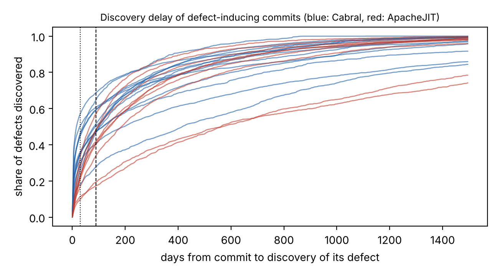
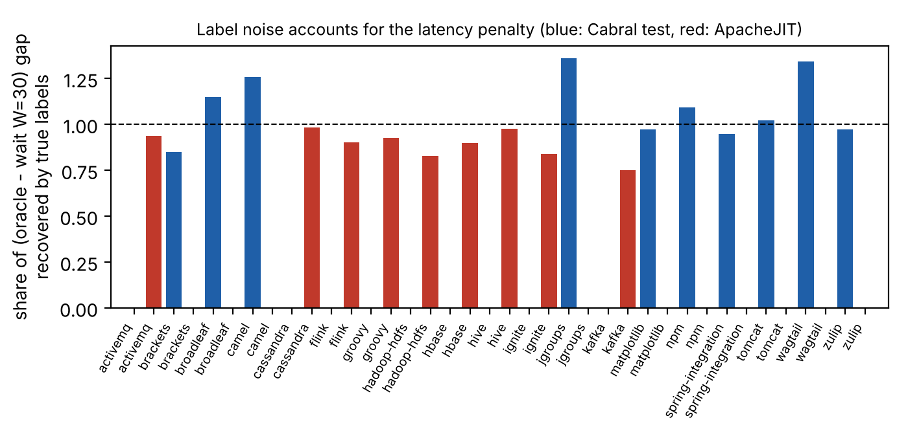

# Where does verification latency hurt online just-in-time defect prediction? A label-noise decomposition on 23 projects

**Authors:** [to be completed by the authors]
**Affiliations:** [to be completed by the authors]
**Corresponding author:** [to be completed by the authors]

## Abstract

**Context.** Online just-in-time software defect prediction (JIT-SDP) flags risky commits as they arrive and retrains as labels come in. A commit's defect label, however, is known only once a later bug fix points back to it. In the 23 projects we study, the median time from commit to discovery is 16–568 days per project, so every recent "clean" commit is only provisionally clean. The standard remedy is to wait W days before trusting a clean label, and it is usually described as a trade-off between label noise and stale data.

**Objective.** We measure how much of the accuracy lost to verification latency is due to label noise and how much is due to missing recent data. We then test whether practical corrections recover that loss.

**Method.** We run a prequential simulation (one shared LightGBM learner, retrained every 100 commits). It covers 14 projects from Cabral et al. (4 for development, 10 held out) and a fresh confirmation set of 9 ApacheJIT projects (331,937 commits in total). All hypotheses and configurations were frozen before any held-out run; seeds, splits and tuning budgets were fixed in advance.

**Results.**
- Waiting 90 days removes only a median 15.3% of the false-clean labels in the training data.
- Giving the same waited-out training set its true labels recovers essentially all of the gap between a 30-day waiting rule and an oracle. The recovered share is 1.08 on the 10 held-out Cabral projects (10/10 projects, Holm-adjusted p = 0.0039) and 0.90 on the 9 fresh ApacheJIT projects (9/9 projects, Holm p = 0.0078). The verification-latency penalty is therefore mainly label noise from old, still-undiscovered defects, not a lack of fresh data.
- Corrections that use only commit age cannot find these defects. A latency-aware weighting built on a truncation-corrected delay estimate and an adaptive waiting time both fail to beat a tuned 90-day wait.
- Feature-based denoisers, an ODaSC-style rule and two variants of our own, recover part of the gap on fresh data. None beats the waiting baselines in the pre-registered confirmatory test.
- Much of the reported difference between label policies lies in where scores cross the decision threshold. A latency-corrected threshold lifts a 30-day wait from 0.621 to 0.744 G-mean on development projects.

**Conclusion.** Future work on verification latency should target dormant defects among old provisionally clean commits. It should also report ranking and operating-point metrics separately.

**Keywords:** just-in-time defect prediction; verification latency; label noise; online learning; data streams; empirical software engineering

---

## 1 Introduction

Teams use just-in-time software defect prediction (JIT-SDP) to decide which incoming commits deserve a careful review (Kamei et al. 2013). In an online deployment the model is retrained as the project evolves (Cabral et al. 2019; Tabassum et al. 2023; Cabral et al. 2023). This exposes a problem that offline studies hide: a commit's label is not available when it is made. A defect it introduces is discovered only when a later bug-fixing commit is traced back to it, typically with SZZ. In the projects studied here that takes a median of 16 to 568 days per project, and the 90th percentile ranges from 383 to 2811 days (Table 1, Fig. 1). At any moment the most recent "clean" commits are therefore only provisionally clean.

The established remedy is the *waiting-time* rule of Cabral et al. (2019): a commit is used as a clean training example only after W days without a discovered defect. Later work treats the choice of W as a trade-off between label noise and staleness (Cabral & Minku 2023; Song et al. 2023a). It also proposes methods that estimate the confidence of waited-out clean labels, ODaSC (Song et al. 2022), or that bring in human labels (Song et al. 2023b). Recent journal papers on JIT-SDP evaluate offline with final labels and do not model verification latency at all; MSTDP, in this journal, is an example (Liu et al. 2026).

Our own starting point was a method. Borrowing the delayed-feedback model of conversion-rate prediction (Chapelle 2014), we weighted each provisionally clean commit by the posterior probability that it hides an undiscovered defect, given its age. The posterior combined a right-truncation-corrected estimate of the discovery-delay distribution (Lagakos et al. 1988) with a prior. **It did not work.** On the four development projects the pre-specified version lost to a tuned waiting rule by up to 0.34 G-mean on one project. On the ten held-out projects it lost to the 90-day wait by 0.038 G-mean (Section 5.3).

Diagnosing that failure changed the question we asked. Our first diagnosis suggested that label noise was a *small* part of the latency penalty: waiting barely reduces the share of false-clean labels (Section 5.1), and ODaSC's oracle-confidence variant performs no better than its estimated one (Song et al. 2022). We wrote down the hypothesis that true labels would recover less than a third of the gap between the waiting rule and the oracle, and tested it with a decomposition. **The hypothesis was refuted.** True labels on the waited-out training set recover almost the whole gap (Section 5.2). Waiting does not remove the noise, the noise stays, and it is what costs accuracy. This reframed the problem from "how long should we wait" to "how do we find dormant defects among old provisionally clean commits", and it explains why our age-based method had to fail.

This paper reports that journey as an empirical study. The contributions are:

1. **A commit-level, online decomposition of the verification-latency penalty**, pre-registered and replicated on two dataset families. Label noise among old provisionally clean commits accounts for 108% (Cabral, 10 held-out projects) and 90% (ApacheJIT, 9 fresh projects) of the gap between a 30-day waiting rule and an oracle (Table 3, Fig. 2). Dormant defects are known to hurt release-level defect prediction (Falessi et al. 2022). We show the commit-level, online counterpart and quantify it.
2. **A model-free characterisation of the noise under waiting** (Table 2). Waiting 90 days removes only 4.6%–33.2% of the false-clean labels; the remaining ones are old commits whose defects take longer than W to surface.
3. **Evidence that age-only corrections cannot recover the penalty, with the mechanism** (Table 4). We evaluate a truncation-corrected latency-aware weighting and an adaptive waiting time. Both fail on held-out projects, and our diagnostics explain why: undiscovered defects are mostly old, so age carries little information about *which* old commit is defective, and using the online model's own score creates a self-confirming loop.
4. **A pre-registered test of feature-based denoisers on fresh data** (Table 5). An ODaSC-style rule and two variants of our own close part of the gap but do not beat the waiting baselines under the confirmatory criterion. We report these as negative or inconclusive results, with all effort-aware metrics.
5. **An operating-point analysis** (Tables 6–7). Much of the apparent difference between label policies is a threshold effect, so we argue that studies should report ranking and threshold-dependent metrics separately.
6. **A reproducible protocol** with leakage tests, frozen plans and a full count of every variant tried (98 logged configurations across two independent analysis lineages, Section 4.6).

## 2 Background and related work

### 2.1 Online JIT-SDP and verification latency

JIT-SDP predicts whether a commit induces a defect from change metrics such as size, diffusion, history and developer experience (Kamei et al. 2013). Labels are usually produced by SZZ, which links bug-fixing commits back to the commits that introduced the bug. SZZ itself introduces errors (Fan et al. 2021; Rosa et al. 2021; Guo et al. 2024; Bludau & Pretschner 2026). Online JIT-SDP evaluates prequentially: each commit is predicted when it arrives and the learner is updated as labels become available (Cabral et al. 2019; Tabassum et al. 2023; Cabral et al. 2023; Sahar et al. 2024). Cabral et al. (2019) introduced the waiting-time rule together with ORB, an oversampling scheme that tracks class-imbalance evolution. Song et al. (2023a) showed that retrospective evaluation can misjudge methods if waiting time is not modelled, and Song et al. (2023b) proposed human labelling to shorten the wait. Grzenda et al. (2020) discuss delayed-label evaluation for data streams in general.

### 2.2 One-sided label noise and dormant defects

A defect discovered after the wait leaves behind a wrongly clean example: the noise is one-sided. ODaSC (Song et al. 2022) is the closest prior work to ours. It estimates the confidence of each waited-out clean label from the class composition of feature-space micro-clusters, and counts low-confidence examples as both classes. On release-level data, Ahluwalia et al. (2019) and Falessi et al. (2022) showed that classes whose defects are still dormant ("snoring") lower recall, and that discarding the most recent release's clean classes helps. Chen et al. (2014) studied dormant bugs directly. Tian et al. (2026) combine waiting time with test feedback. To our knowledge, no prior study decomposes the online, commit-level verification-latency penalty into its noise and freshness parts with a pre-registered design.

### 2.3 Delayed feedback and positive-unlabeled learning

Conversion-rate prediction faces the same structure: a conversion may arrive after the click is logged. Chapelle (2014) weighted a not-yet-converted example by the posterior p·S(e)/(1 − p + p·S(e)), where S is the survival function of the delay and e the elapsed time. Our latency-aware weighting uses the same posterior, and we credit it to that work. Later methods correct the bias with importance weights or label correction (Yasui et al. 2020; Yang et al. 2021; Chen et al. 2022; Yasui & Kato 2022). Viewed as positive-unlabeled learning, the label frequency here depends on age (Elkan & Noto 2008; Bekker & Davis 2020). There is one difference from clicks. In conversion-rate prediction the whole cohort of clicks is observed; in JIT-SDP a defective commit becomes visible only through its fix, so the observed delays are right-truncated. We therefore estimate S with the reverse-time product-limit estimator for right-truncated data (Lagakos et al. 1988; Kalbfleisch & Lawless 1989). Hofer et al. (2024) address verification latency in Bayesian stream classification. General label-noise methods such as confident learning (Northcutt et al. 2021) do not use label timing.

### 2.4 Claim, closest prior work and difference

| Claim | Closest prior work | Exact difference |
|---|---|---|
| C1: the online latency penalty is mostly label noise from old dormant defects | Falessi et al. 2022 (dormant defects, release level) | Commit level, online prequential, quantified as a share of the wait–oracle gap, pre-registered, replicated on two dataset families |
| C2: age-only corrections cannot remove it | Cabral et al. 2019 (waiting time); Chapelle 2014 (delay posterior) | We test the truncation-corrected delay posterior in JIT-SDP and show why it fails (old defects, self-confirmation) |
| C3: feature-based denoising helps only partially on fresh data | Song et al. 2022 (ODaSC) | Equal tuning budget, shared learner, fresh dataset, confirmatory statistics; no significant win |
| C4: label-policy comparisons are confounded by the operating point | — (threshold moving is standard; not analysed for latency policies) | Quantifies how much of the G-mean spread between policies disappears at each policy's best threshold |

### 2.5 Positioning with respect to this journal

The only JIT-SDP paper published in this journal since 2023 that we could find is MSTDP (Liu et al. 2026). Its comparison is offline, on one chronological 80/20 split of nine of the same Cabral projects, and uses final labels for training. Under our protocol that corresponds to the *oracle* condition, which no deployed model can reach. Its results and ours are therefore not directly comparable, and we make no claim of outperforming it.

## 3 Study design

### 3.1 Prequential simulation with verification latency

For each project, commits are ordered by author time. A first model is trained after 500 commits, and the model is then retrained every 100 commits. At an update time T, the training set consists of the commits made before T with the labels *observable at T*: a commit is positive if it is defect-inducing and its defect was discovered (first fixing commit) by T, and provisionally clean otherwise. Each commit made between T and the next update is predicted at commit time and scored against its *final* label. The last 365 days of each project are excluded from scoring because their final labels are the least complete.

All label policies share one learner: LightGBM with 150 trees, learning rate 0.05, 31 leaves, 0.8 row and column subsampling, class-balanced weights and a 0.5 threshold, trained on the 14 log-transformed Kamei change metrics. Differences between methods therefore come only from how the training labels are built, plus the threshold rule in Section 5.5.

### 3.2 Label policies

- **Oracle.** True final labels immediately. An upper bound, not deployable.
- **No-wait.** Observed labels at face value.
- **Wait-W.** Positives as soon as they are discovered; clean commits only after W days (Cabral et al. 2019). W is tuned on development projects over {15, 30, 60, 90, 180}.
- **ORB-W.** Wait-W plus ORB's class-weight boosting from the moving average of predictions (Cabral et al. 2019), with the parameters published there.
- **Adaptive waiting (AWT).** A per-project, per-update W_T: the smallest age at which the estimated probability that a defect is still undiscovered drops to ε.
- **Latency-aware weighting (LAW).** Every provisionally clean commit of age a is split into a positive copy with weight q and a negative copy with weight 1 − q, where q = p·S(a)/(1 − p + p·S(a)). Here S(a) is the probability that a defect is still undiscovered at age a, estimated from the discoveries observed before T with the truncation-corrected estimator. The prior p is either the base rate or the previous model's de-weighted probability.
- **ODaSC-style.** An adaptation of Song et al. (2022) to the shared learner. Each waited-out clean commit gets a clean-label confidence equal to the share of clean labels among its k nearest labelled neighbours; below the threshold θ it is counted as both classes. The kNN neighbourhood replaces DenStream micro-clusters.
- **Mature-scorer denoiser (LAW-M).** A variant of our own, designed after the diagnosis in Section 5.3. Old provisionally clean commits (age ≥ W) receive the posterior q above, but p comes from scorers trained only on mature commits (age ≥ 365 days) with two-fold cross-fitting, so no commit is scored by a model trained on it and the online model's own score is never used.
- **Dual.** LAW-M combined with the ODaSC-style neighbour share r by a noisy-OR, 1 − (1 − q)(1 − r).
- **Decomposition (diagnostic only).** Level 1 keeps exactly the training commits of Wait-W but gives them their true labels (pure denoising). Level 2 additionally adds young, not-yet-discovered defective commits. The oracle further adds the young clean commits. This decomposition uses true labels and is never a competitor.

### 3.3 Research questions

- **RQ1** How much label noise remains after waiting, and where is it?
- **RQ2** Which part of the verification-latency penalty is label noise, and which part is missing recent data?
- **RQ3** Can corrections that use only commit age recover the penalty?
- **RQ4** Do feature-based denoisers recover it on fresh data?
- **RQ5** How much of the measured difference between label policies is an operating-point effect?

## 4 Experimental setup

### 4.1 Datasets

We use two dataset families (Table 1).

**Cabral et al.** The ICSE 2019 artifact (Zenodo 10.5281/zenodo.2591761) contains 14 GitHub projects with commit timestamps, 14 change metrics and defect-discovery events (265,003 commits after cleaning). One seeded random draw, made before any modelling, split them by project into four **development** projects (fabric, neutron, nova, sentry), used for all tuning and diagnosis, and ten **held-out test** projects.

**ApacheJIT.** ApacheJIT (Keshavarz & Nagappan 2022; Zenodo 10.5281/zenodo.5907847, CC-BY-4.0) serves as a **fresh confirmation** set of nine projects with at least 2,000 commits (66,934 commits). We exclude camel because it overlaps a Cabral test project, and hadoop because it has no defective commits. Discovery time is the earliest fix date among the SZZ links of a defective commit. ApacheJIT has no `lt` metric, which is set to a constant.

Defect rates are 0.123–0.276 in Cabral and 0.200–0.764 in ApacheJIT. ApacheJIT is a curated sample of commits rather than complete histories (Section 7).

**Table 1.** Projects, defect rates and discovery delays of defect-inducing commits (computed from the data; `paper/tables/T1_datasets.md`).

| project | family | role | commits | years | defect rate | median delay (d) | P90 delay (d) | share found after 90 d |
|:--|:--|:--|--:|--:|--:|--:|--:|--:|
| fabric | Cabral | dev | 13003 | 6.1 | 0.199 | 40 | 383 | 0.351 |
| neutron | Cabral | dev | 19450 | 6.9 | 0.237 | 102 | 520 | 0.533 |
| nova | Cabral | dev | 48937 | 7.7 | 0.254 | 97 | 556 | 0.518 |
| sentry | Cabral | dev | 21471 | 10.7 | 0.239 | 46 | 646 | 0.406 |
| brackets | Cabral | test | 17310 | 5.7 | 0.234 | 16 | 606 | 0.312 |
| broadleaf | Cabral | test | 14910 | 8.8 | 0.169 | 45 | 880 | 0.406 |
| camel | Cabral | test | 30517 | 10.7 | 0.205 | 29 | 740 | 0.393 |
| jgroups | Cabral | test | 18316 | 14.1 | 0.172 | 117 | 1273 | 0.529 |
| matplotlib | Cabral | test | 19061 | 8.0 | 0.161 | 115 | 1030 | 0.528 |
| npm | Cabral | test | 7892 | 8.0 | 0.178 | 104 | 706 | 0.530 |
| spring-integration | Cabral | test | 8691 | 9.9 | 0.268 | 416 | 1964 | 0.722 |
| tomcat | Cabral | test | 18877 | 11.7 | 0.276 | 196 | 1862 | 0.592 |
| wagtail | Cabral | test | 8103 | 5.0 | 0.123 | 87 | 622 | 0.496 |
| zulip | Cabral | test | 18465 | 6.4 | 0.244 | 82 | 1010 | 0.482 |
| activemq | ApacheJIT | fresh | 6126 | 14.0 | 0.229 | 568 | 2151 | 0.826 |
| cassandra | ApacheJIT | fresh | 8159 | 10.8 | 0.382 | 142 | 693 | 0.596 |
| flink | ApacheJIT | fresh | 11691 | 9.0 | 0.240 | 96 | 491 | 0.518 |
| groovy | ApacheJIT | fresh | 8059 | 16.3 | 0.200 | 561 | 2811 | 0.806 |
| hadoop-hdfs | ApacheJIT | fresh | 2907 | 10.5 | 0.764 | 188 | 966 | 0.659 |
| hbase | ApacheJIT | fresh | 8730 | 12.7 | 0.433 | 137 | 792 | 0.588 |
| hive | ApacheJIT | fresh | 6842 | 11.3 | 0.617 | 97 | 611 | 0.516 |
| ignite | ApacheJIT | fresh | 12036 | 5.8 | 0.203 | 129 | 700 | 0.580 |
| kafka | ApacheJIT | fresh | 2384 | 8.2 | 0.468 | 67 | 416 | 0.430 |

**Fig. 1.** Cumulative share of defects discovered as a function of the time since the defect-inducing commit, per project (blue: Cabral; red: ApacheJIT). Dotted and dashed lines mark 30 and 90 days. In every project a large share of defects surfaces after 90 days (0.312–0.722 in Cabral, 0.430–0.826 in ApacheJIT).

### 4.2 Metrics

The primary metric is the G-mean of the per-class recalls (recall-1 for defective, recall-0 for clean), computed over the evaluation window against final labels, as in Cabral et al. (2019). We also report ROC-AUC (ranking quality, independent of the threshold) and MCC. On ApacheJIT we additionally report the effort-aware metrics common in JIT-SDP: F1, Recall@20% effort, Popt and IFA (Table 5).

### 4.3 Tuning budget and seeds

Every tuned method received at most five configurations, evaluated on the development projects with exploration seeds {0, 1, 2}. Wait and ORB used the W grid; the ODaSC-style rule used W ∈ {30, 90} × θ ∈ {0.8, 0.9} with k = 20; LAW-M and Dual used four configurations each. The confirmation seeds {100, …, 104} were fixed at the start of the project and never changed. The unit of analysis is the project (mean over 5 seeds); n = 10 for Cabral test and n = 9 for ApacheJIT.

### 4.4 Statistics

Paired comparisons use the two-sided Wilcoxon signed-rank test over projects, with Holm correction within each pre-registered family, a 95% bootstrap confidence interval of the mean paired difference (10,000 resamples) and the rank-biserial correlation. A gain counts as non-trivial at ≥ 0.02 G-mean, a margin fixed in the first plan. With n = 9 the smallest two-sided Wilcoxon p-value for an 8/1 split is about 0.04, which limits power on ApacheJIT.

### 4.5 Leakage checks

- A unit test (`tests/test_no_future.py`) hides every defect discovery after a cut time T0 and verifies that no prediction made before T0 changes. It covers every label policy and both threshold rules.
- Delay estimators use only discoveries observed before T.
- Development and test projects are disjoint, and no hyperparameter was chosen on test or fresh projects.
- Each confirmation used a frozen configuration written to `state/` before the run.

### 4.6 Analysis history and multiplicity

The study was conducted by an automated, logged research process. That process included two independent analysis lineages that started from the same infrastructure. Both are reported:

- the **main lineage** (RQ1–RQ4; 1,526 simulation runs, 47 logged configurations);
- an **independent lineage** (RQ5; 996 runs, 51 logged configurations).

Both lineages ran a frozen confirmation on the same ten Cabral test projects, and each counts as a separate use of that test set. The ApacheJIT confirmation was run once. All plans (`experiments/plan_v1`–`v7`), decisions and the variant ledger are in the replication package.

## 5 Results

### 5.1 RQ1: Waiting barely cleans the labels

Table 2 measures, without any model, the share of training negatives that are in fact defect-inducing, averaged over update times. Going from no waiting to W = 90 days lowers this share by only 4.6%–33.2% (median 15.3%) across the 14 Cabral projects, while excluding 4.8%–13.8% of the history. The remaining false-clean commits are old. Among commits older than two years, 0.1%–9.7% of the provisionally clean ones are still truly defective; among commits younger than seven days the share is 12.2%–26.2%, roughly the base rate.

**Table 2.** False-clean share of training negatives under waiting (W in days) and by commit age (`paper/tables/T2_rq1_label_noise.md`; model-free, all 14 Cabral projects).

| project            |   W=0 |   W=30 |   W=90 |   excluded at W=90 |   age < 7 d |   age > 2 y |
|:-------------------|------:|-------:|-------:|-------------------:|------------:|------------:|
| brackets           | 0.057 |  0.051 |  0.044 |              0.118 |       0.194 |       0.014 |
| broadleaf          | 0.050 |  0.047 |  0.043 |              0.076 |       0.160 |       0.022 |
| camel              | 0.043 |  0.041 |  0.038 |              0.049 |       0.168 |       0.021 |
| fabric             | 0.032 |  0.027 |  0.021 |              0.096 |       0.161 |       0.001 |
| jgroups            | 0.043 |  0.041 |  0.038 |              0.052 |       0.164 |       0.019 |
| matplotlib         | 0.066 |  0.064 |  0.061 |              0.075 |       0.140 |       0.046 |
| neutron            | 0.112 |  0.107 |  0.099 |              0.102 |       0.234 |       0.081 |
| nova               | 0.069 |  0.062 |  0.054 |              0.070 |       0.262 |       0.020 |
| npm                | 0.044 |  0.039 |  0.033 |              0.078 |       0.202 |       0.008 |
| sentry             | 0.055 |  0.051 |  0.045 |              0.081 |       0.202 |       0.015 |
| spring-integration | 0.129 |  0.125 |  0.119 |              0.085 |       0.239 |       0.074 |
| tomcat             | 0.125 |  0.123 |  0.119 |              0.048 |       0.249 |       0.097 |
| wagtail            | 0.044 |  0.040 |  0.034 |              0.138 |       0.122 |       0.009 |
| zulip              | 0.093 |  0.085 |  0.076 |              0.122 |       0.235 |       0.056 |

**Answer to RQ1.** Waiting removes young negatives but leaves almost all of the noise, because the noise sits in old commits whose defects surface after any practical W.

### 5.2 RQ2: The latency penalty is mostly label noise

Before running the decomposition on development projects we wrote down hypothesis H2a: true labels on the waited-out set would recover *less than a third* of the gap between waiting and the oracle. On development projects the opposite happened. At W = 30, mean G-mean rose from 0.621 to 0.785 against an oracle of 0.794. We then pre-registered the reverse hypothesis (H3) for the held-out projects and later for the fresh ApacheJIT projects.

Table 3 and Fig. 2 show the confirmations. On the ten held-out Cabral projects, Wait-30 reaches 0.620 and the same training set with true labels reaches 0.722, slightly above the oracle (0.715). The recovered share of the gap is 1.08 (per project 0.849–1.36). The denoised Wait-30 beats Wait-90 by +0.068 (95% CI [0.049, 0.092], 10 wins/0 losses, Holm p = 0.0039) and Wait-30 by +0.102 (CI [0.069, 0.141], 10/0, Holm p = 0.0039). On the nine fresh ApacheJIT projects, denoising lifts Wait-30 from 0.687 to 0.762 against an oracle of 0.770: a recovered share of 0.90 (per project 0.75–0.983). The denoised set beats Wait-90 by +0.045 (CI [0.029, 0.062], 9/0, Holm p = 0.0078).

Two further observations sharpen the picture:
- Adding the young, not-yet-discovered defective commits *without* their clean neighbours (level 2) hurts: 0.702 versus 0.722 at W = 30 on Cabral test. It inflates recall-1 at the expense of recall-0.
- With clean labels, a *shorter* wait is better (0.722 at W = 30 versus 0.684 at W = 90). Fresh data does matter, but only once its labels are clean.

**Table 3.** Mean G-mean of the decomposition (`paper/tables/T3_rq2_decomposition_means.md`). L1 = waited-out training set with true labels; L2 = L1 plus young undiscovered defective commits.

| condition | Cabral test (10) | ApacheJIT (9) |
|:--|--:|--:|
| Wait-30 | 0.620 | 0.687 |
| Wait-30, true labels (L1) | 0.722 | 0.762 |
| Wait-30, L2 | 0.702 | — |
| Wait-90 | 0.654 | 0.716 |
| Wait-90, true labels (L1) | 0.684 | — |
| Wait-90, L2 | 0.625 | — |
| Oracle | 0.715 | 0.770 |

**Fig. 2.** Share of the gap between Wait-30 and the oracle that is recovered by giving the same training commits their true labels, per project (blue: Cabral test; red: ApacheJIT). The dashed line marks full recovery.

**Answer to RQ2.** On both dataset families the verification-latency penalty of a short waiting time is essentially label noise from old, still-undiscovered defects. Excluding young negatives costs little; keeping old false-clean commits costs a lot. This contradicts the usual reading of W as a noise-versus-freshness trade-off. Our own earlier reading of the RQ1 numbers ("waiting barely changes the noise, so noise must be unimportant") was wrong for the same reason.

### 5.3 RQ3: Age-only corrections cannot recover it

Table 4 reports the frozen age-only methods on the ten held-out Cabral projects. Both lose to a tuned 90-day wait:
- **LAW (truncation-corrected delay, model prior):** 0.616 G-mean, −0.038 against Wait-90 (CI [−0.085, 0.001], 3 wins/7 losses, Holm p = 0.168) and −0.042 against ORB-90 (CI [−0.091, −0.003], 2/8, Holm p = 0.168).
- **Adaptive waiting (ε = 0.4):** 0.619 G-mean, −0.039 against ORB-90 (CI [−0.077, −0.009], 2/8, Holm p = 0.0742).

Both beat the no-wait baseline (+0.187 and +0.190, 10/0, Holm p = 0.0059).

**Table 4.** Age-only label policies on the ten held-out Cabral projects (mean of per-project means over 5 confirmation seeds; `paper/tables/T4_rq3_age_only_cabral_test.md`, per project in `T4b`).

| method | G-mean | AUC | recall-1 | recall-0 |
|:--|--:|--:|--:|--:|
| Oracle (bound) | 0.715 | 0.815 | 0.626 | 0.820 |
| ORB-90 | 0.658 | 0.724 | 0.714 | 0.615 |
| Wait-90 | 0.654 | 0.727 | 0.713 | 0.616 |
| Adaptive waiting (ε = 0.4) | 0.619 | 0.699 | 0.675 | 0.609 |
| LAW (lagakos, model prior) | 0.616 | 0.751 | 0.453 | 0.860 |
| No-wait | 0.429 | 0.722 | 0.209 | 0.950 |

Diagnostics on development projects explain the failure (`results/diag_law_neutron.json`, `results/diag_survival_dev.txt`):

1. **The delay estimator is not the problem.** On neutron, the truncation-corrected S(a) at 7/30/90 days was 0.867/0.696/0.462, against true values of 0.881/0.728/0.515.
2. **The model prior creates a self-confirming loop.** Low scores give provisionally clean commits a small q, the next model sees fewer positives, and recall-1 decays over time. On neutron it fell to 0.10 in the second evaluation quarter, while the predicted-positive rate dropped to 0.04 against a true rate of 0.28.
3. **The base-rate prior gives almost no separation.** Without the model prior, q barely separates truly defective provisionally clean commits (mean 0.086) from clean ones (0.061): undiscovered defects are mostly old, where S(a) is small, so age carries little information.

LAW still ranks commits better than Wait-90 (AUC 0.751 versus 0.727). It loses at the operating point (recall-1 0.453 versus 0.713), a theme we return to in RQ5.

**Answer to RQ3.** No: commit age can down-weight young data, but it cannot tell which old provisionally clean commit hides a dormant defect, and that is where RQ2 locates the penalty.

### 5.4 RQ4: Feature-based denoisers on fresh data

RQ2 and RQ3 point to a different requirement: find dormant defects among old provisionally clean commits from the commit's features, without letting the online model confirm its own mistakes. We froze three such denoisers on development projects:
- the ODaSC-style rule (W = 30, θ = 0.8);
- LAW-M (mature, cross-fitted scorers; W = 30);
- Dual (LAW-M noisy-OR the neighbour share; W = 30, k = 50).

On development projects the ODaSC-style rule had the best mean (0.760), against LAW-M 0.755 and Dual 0.681. Dual collapsed on nova. By the pre-registered rule, the ODaSC-style configuration therefore became the primary candidate for the fresh ApacheJIT confirmation, and LAW-M and Dual were reported descriptively.

**Confirmatory result (H6).** The primary candidate did not beat the waiting baselines: +0.0012 against Wait-90 (CI [−0.012, 0.012], 6 wins/3 losses, Holm p = 0.6016) and +0.0114 against ORB-90 (CI [−0.007, 0.030], 6/3, Holm p = 0.6016). H6 fails.

**Descriptive results (not confirmatory).**
- **Dual** had the highest mean G-mean of any deployable method (0.735) and the best AUC (0.808). It beat the ODaSC-style rule on 8 of 9 projects, +0.0175 with CI [0.003, 0.032], but Holm p = 0.164.
- **LAW-M** reached 0.728.

Because Dual was not the pre-registered primary candidate and failed on a development project, we do not claim it as an improvement.

**Table 5.** Fresh ApacheJIT confirmation (9 projects × 5 confirmation seeds, configurations frozen on Cabral development projects; `paper/tables/T5_rq4_apachejit_all_metrics.md`, per project in `T5b`). Higher is better except IFA.

| method | G-mean | AUC | recall-1 | recall-0 | F1 | MCC | Recall@20% | Popt | IFA |
|:--|--:|--:|--:|--:|--:|--:|--:|--:|--:|
| Oracle (bound) | 0.770 | 0.862 | 0.750 | 0.800 | 0.725 | 0.537 | 0.637 | 0.893 | 2.111 |
| Dual (W30, k50) | 0.735 | 0.808 | 0.768 | 0.709 | 0.707 | 0.458 | 0.618 | 0.877 | 4.756 |
| LAW-M (W30) | 0.728 | 0.796 | 0.681 | 0.789 | 0.690 | 0.458 | 0.597 | 0.859 | 2.733 |
| ODaSC-style (W30, θ0.8) | 0.718 | 0.788 | 0.684 | 0.765 | 0.679 | 0.433 | 0.594 | 0.858 | 3.067 |
| Wait-90 | 0.716 | 0.787 | 0.645 | 0.807 | 0.671 | 0.439 | 0.599 | 0.860 | 13.756 |
| ORB-90 | 0.706 | 0.777 | 0.634 | 0.790 | 0.649 | 0.405 | 0.587 | 0.853 | 12.667 |
| Wait-30 | 0.687 | 0.783 | 0.554 | 0.863 | 0.631 | 0.426 | 0.584 | 0.849 | 2.400 |
| No-wait | 0.648 | 0.774 | 0.476 | 0.899 | 0.578 | 0.399 | 0.566 | 0.833 | 1.978 |

**Answer to RQ4.** Feature-based denoisers recover part of the penalty on fresh data. In the mean, Dual closes about a third of the distance from Wait-90 (0.716) to the oracle (0.770). None of them passed the pre-registered confirmatory test, and the gap between the best real denoiser (0.735) and the true-label decomposition (0.762) shows how much is still to gain.

### 5.5 RQ5: Label-policy comparisons are confounded by the operating point

A development diagnostic (fabric and neutron, seed 0; independent lineage) compares each policy at the fixed threshold 0.5 and at its own best threshold, chosen on the same data and used only for diagnosis (Table 6). On fabric the G-mean spread across the non-oracle policies is 0.474–0.676 at 0.5 but only 0.668–0.717 at the best threshold; on neutron, 0.246–0.819 versus 0.765–0.843. No-wait, the worst policy at 0.5, has the best ranking of all non-oracle policies on fabric.

**Table 6.** Development diagnostic of the operating point (`paper/tables/T6_rq5_operating_point_dev.md`; the best threshold is a diagnostic upper bound, never used for selection).

| project | policy | AUC | G-mean @0.5 | G-mean @best thr. | predicted-positive rate | true rate |
|:--|:--|--:|--:|--:|--:|--:|
| fabric | No-wait | 0.778 | 0.474 | 0.717 | 0.077 | 0.207 |
| fabric | Wait-90 | 0.724 | 0.636 | 0.668 | 0.588 | 0.207 |
| fabric | ORB-90 | 0.738 | 0.655 | 0.679 | 0.550 | 0.207 |
| fabric | LAW (base prior) | 0.754 | 0.676 | 0.702 | 0.252 | 0.207 |
| fabric | LAW (model prior) | 0.769 | 0.670 | 0.709 | 0.252 | 0.207 |
| neutron | No-wait | 0.829 | 0.246 | 0.765 | 0.023 | 0.256 |
| neutron | Wait-90 | 0.896 | 0.787 | 0.842 | 0.307 | 0.256 |
| neutron | ORB-90 | 0.897 | 0.819 | 0.843 | 0.352 | 0.256 |
| neutron | LAW (base prior) | 0.876 | 0.684 | 0.818 | 0.214 | 0.256 |
| neutron | LAW (model prior) | 0.888 | 0.504 | 0.829 | 0.094 | 0.256 |

**A deployable threshold rule.** The independent lineage then tested a threshold rule that uses only information available at time T. At each update it picks the threshold that maximises G-mean on the last 2,000 scored commits, weighting not-yet-discovered commits as soft positives through the same delay posterior. On development projects this rule lifted Wait-30 from 0.621 to 0.744 and No-wait from 0.385 to 0.688. A rate-matching alternative, pre-registered alongside it, did not help (Section 6.3).

In that lineage's frozen confirmation on the ten Cabral test projects (Table 7), LAW with this threshold reached 0.696:
- against Wait-90: +0.042 (CI [0.026, 0.058], 9/1, Holm p = 0.0195);
- against ORB-90: +0.038 (CI [0.022, 0.051], 9/1, Holm p = 0.0195);
- against the ODaSC-style rule: +0.0009 (CI [−0.009, 0.011], 6/4, Holm p = 1.0), i.e. a tie.

**Table 7.** Threshold-rule confirmation on the ten Cabral test projects (independent lineage; `paper/tables/T7_rq5_threshold_cabral_test_independent_lineage.md`). "+thr" = latency-corrected G-mean threshold. This lineage's ODaSC-style rule uses k = 50 and δ = 0.9.

| method | G-mean | AUC | recall-1 | recall-0 |
|:--|--:|--:|--:|--:|
| LAW (model prior) +thr | 0.696 | 0.751 | 0.745 | 0.651 |
| ODaSC-style W15 +thr | 0.695 | 0.764 | 0.724 | 0.670 |
| ODaSC-style W30 | 0.695 | 0.762 | 0.766 | 0.635 |
| Wait-30 +thr | 0.676 | 0.745 | 0.699 | 0.657 |
| ORB-90 | 0.658 | 0.724 | 0.714 | 0.615 |
| Wait-90 | 0.654 | 0.727 | 0.713 | 0.616 |
| No-wait | 0.429 | 0.722 | 0.209 | 0.950 |
| Oracle (bound) | 0.715 | 0.815 | 0.626 | 0.820 |

**Answer to RQ5.** A large part of the G-mean differences between latency policies at a fixed threshold is an operating-point effect. Correcting the threshold with latency-aware information turned LAW from a loser (RQ3) into a method that beats the waiting baselines, but not the ODaSC-style rule. Studies of label policies should therefore report a threshold-free ranking metric (AUC) next to G-mean.

## 6 Discussion

### 6.1 What the decomposition implies for practice and research

- **The waiting rule is not the lever.** No single W both keeps fresh data and removes noise, because the noise does not age out on any practical horizon (Table 1: 31%–83% of defects surface after 90 days).
- **Fresh data helps only once its labels are clean.** With true labels, a 30-day set beats a 90-day set on held-out projects (Table 3).
- **Methods should target old provisionally clean commits** with commit-level evidence. Feature-neighbourhood confidence (ODaSC) and mature, cross-fitted scorers both do this. On fresh data they recover part of the gap, and a large remainder separates them from the true-label bound (0.735 versus 0.762 on ApacheJIT).
- **Evaluate with care.** An operating-point shift can reverse the ranking of label policies (Table 6), so AUC and G-mean should be reported together.

### 6.2 Relation to dormant defects and SZZ noise

Our finding is the online, commit-level counterpart of the "snoring" effect at release level (Ahluwalia et al. 2019; Falessi et al. 2022). The mechanism is the same: defects whose fixes have not yet happened. The consequence differs. At release level, dropping the latest release is an effective fix. Under online waiting, the harmful examples are *old* commits that no realistic cut-off removes. Our labels inherit SZZ's errors (Fan et al. 2021; Rosa et al. 2021). Our "true" labels are the final dataset labels, so the decomposition measures latency noise relative to SZZ-final labels, not relative to ground truth.

### 6.3 What did not work, and why we report it

We report every approach we froze and tested:
- the pre-specified LAW;
- adaptive waiting (abandoned on development projects, kept in the variant count);
- a rate-matching threshold rule that we pre-registered alongside the G-mean rule (it did not help on development projects: LAW-base 0.678, No-wait 0.633);
- the Dual denoiser's collapse on one development project.

Our first interpretation of RQ1 was also wrong (Section 5.2). We include these because the reasons they failed are what led to the decomposition, and because a reader who wants to improve on them needs to know which directions have already been tried.

## 7 Threats to validity

**Construct validity.**
- "True" labels are final SZZ-based labels, which contain errors and may still miss defects not discovered by the end of the data. We exclude the last 365 days from scoring for this reason.
- Discovery time is the first linked fix. In ApacheJIT, defective commits whose fix date precedes the commit date were set as discovered at commit time, and commits without a valid link are never discovered.
- G-mean at a fixed threshold depends on the operating point (RQ5), which is why we also report AUC and the effort-aware metrics.

**Internal validity.**
- The ODaSC-style baseline is an adaptation (kNN neighbourhoods on a shared LightGBM learner), not the original DenStream/Hoeffding-tree implementation. Its absolute numbers are not comparable with those of Song et al. (2022).
- All methods share one learner and one tuning budget, but other learners could rank the policies differently.
- The decomposition uses true labels and is a diagnostic, not a method.

**Conclusion validity.**
- With n = 9 or 10 projects, Wilcoxon tests have limited power. The minimum two-sided p for an 8/1 split at n = 9 is about 0.04.
- The Cabral test set was used for frozen confirmations by two analysis lineages (Section 4.6). The RQ2 decomposition was replicated on fresh data, but RQ5's confirmation exists only on Cabral.
- 98 configurations were logged in total across the two lineages; every confirmatory claim uses frozen configurations and Holm correction within its family.

**External validity.**
- 23 open-source projects (Java, JavaScript, Python) from two dataset families.
- ApacheJIT is a curated sample with high defect rates in some projects (up to 0.764), not complete histories.
- Industrial projects with different review and fixing practices may show different delays.

## 8 Conclusion

We asked where verification latency hurts online JIT-SDP. On 23 projects and two dataset families, the answer is: in old commits that are labelled clean while their defects are still dormant. True labels on the same waited-out training set recover 108% and 90% of the gap between a 30-day wait and an oracle (Holm p = 0.0039 and 0.0078). Age-only corrections, including the truncation-corrected latency-aware weighting we set out to propose, cannot find these commits. Feature-based denoisers find some of them but did not pass our confirmatory test on fresh data. A latency-aware threshold rule beats the waiting baselines but ties the ODaSC-style rule. We release the simulation, the frozen plans and the full variant ledger so that future methods can be measured against the true-label bound that this decomposition provides.

## Declarations

**Data availability.** Cabral et al. dataset: Zenodo 10.5281/zenodo.2591761. ApacheJIT: Zenodo 10.5281/zenodo.5907847 (CC-BY-4.0). Both are downloaded and checksum-verified by `scripts/get_data.py`.

**Code availability.** Simulation, analysis scripts, frozen plans, decision log and variant ledger: [repository URL to be completed by the authors].

**Compute.** CPU only (4 cores, 15 GB RAM); about 44.5 CPU-hours in total across both analysis lineages (29.5 + 15.0).

**Use of AI assistance.** The experiments, analysis and draft were produced with substantial assistance from an AI research agent (Claude, Anthropic) operating under a logged protocol. [Authors to complete according to the journal's AI policy and to verify all content.]

**Funding.** [to be completed by the authors]

**Competing interests.** [to be completed by the authors]

**Ethics approval.** Not applicable (public software repository data). [Authors to confirm.]

**Author contributions.** [to be completed by the authors]

## References

Ahluwalia A, Falessi D, Di Penta M (2019) Snoring: A Noise in Defect Prediction Datasets. 2019 IEEE/ACM 16th International Conference on Mining Software Repositories (MSR). https://doi.org/10.1109/MSR.2019.00019

Bekker J, Davis J (2020) Learning from positive and unlabeled data: a survey. Machine Learning 109(4):719-760. https://doi.org/10.1007/s10994-020-05877-5

Bludau P, Pretschner A (2026) Quantifying SZZ-induced evaluation bias in just-in-time defect prediction. Software Quality Journal 34(4):60. https://doi.org/10.1007/s11219-026-09796-x

Cabral GG, Minku LL (2023) Towards Reliable Online Just-in-Time Software Defect Prediction. IEEE Transactions on Software Engineering 49(3):1342-1358. https://doi.org/10.1109/TSE.2022.3175789

Cabral GG, Minku LL, Oliveira ALI, Pessoa DA, Tabassum S (2023) An investigation of online and offline learning models for online Just-in-Time Software Defect Prediction. Empirical Software Engineering 28(5):121. https://doi.org/10.1007/s10664-023-10335-6

Cabral GG, Minku LL, Shihab E, Mujahid S (2019) Class Imbalance Evolution and Verification Latency in Just-in-Time Software Defect Prediction. 2019 IEEE/ACM 41st International Conference on Software Engineering (ICSE), pp 666-676. https://doi.org/10.1109/ICSE.2019.00076

Chapelle O (2014) Modeling delayed feedback in display advertising. Proceedings of the 20th ACM SIGKDD international conference on Knowledge discovery and data mining, pp 1097-1105. https://doi.org/10.1145/2623330.2623634

Chen TH, Nagappan M, Shihab E, Hassan AE (2014) An empirical study of dormant bugs. Proceedings of the 11th Working Conference on Mining Software Repositories, pp 82-91. https://doi.org/10.1145/2597073.2597108

Chen Y, Jin J, Zhao H, Wang P, Liu G, Xu J, et al. (2022) Asymptotically Unbiased Estimation for Delayed Feedback Modeling via Label Correction. Proceedings of the ACM Web Conference 2022, pp 369-379. https://doi.org/10.1145/3485447.3511965

Elkan C, Noto K (2008) Learning classifiers from only positive and unlabeled data. Proceedings of the 14th ACM SIGKDD international conference on Knowledge discovery and data mining, pp 213-220. https://doi.org/10.1145/1401890.1401920

Falessi D, Ahluwalia A, Penta MD (2022) The Impact of Dormant Defects on Defect Prediction: A Study of 19 Apache Projects. ACM Transactions on Software Engineering and Methodology 31(1):1-26. https://doi.org/10.1145/3467895

Fan Y, Xia X, da Costa DA, Lo D, Hassan AE, Li S (2021) The Impact of Mislabeled Changes by SZZ on Just-in-Time Defect Prediction. IEEE Transactions on Software Engineering 47(8):1559-1586. https://doi.org/10.1109/TSE.2019.2929761

Grzenda M, Gomes HM, Bifet A (2020) Delayed labelling evaluation for data streams. Data Mining and Knowledge Discovery 34(5):1237-1266. https://doi.org/10.1007/s10618-019-00654-y

Guo S, Li D, Huang L, Lv S, Chen R, Li H, et al. (2024) Estimating Uncertainty in Labeled Changes by SZZ Tools on Just-In-Time Defect Prediction. ACM Transactions on Software Engineering and Methodology 33(4):1-25. https://doi.org/10.1145/3637226

Hofer V, Krempl G, Lang D (2024) Anticipative Bayesian classification for data streams with verification latency. Journal of Applied Statistics 51(14):2812-2831. https://doi.org/10.1080/02664763.2024.2319222

Kalbfleisch JD, Lawless JF (1989) Inference Based on Retrospective Ascertainment: An Analysis of the Data on Transfusion-Related AIDS. Journal of the American Statistical Association 84(406):360-372. https://doi.org/10.1080/01621459.1989.10478780

Kamei Y, Shihab E, Adams B, Hassan AE, Mockus A, Sinha A, et al. (2013) A large-scale empirical study of just-in-time quality assurance. IEEE Transactions on Software Engineering 39(6):757-773. https://doi.org/10.1109/TSE.2012.70

Keshavarz H, Nagappan M (2022) ApacheJIT. Proceedings of the 19th International Conference on Mining Software Repositories, pp 191-195. https://doi.org/10.1145/3524842.3527996

Lagakos SW, Barraj LM, Gruttola VD (1988) Nonparametric analysis of truncated survival data, with application to AIDS. Biometrika 75(3):515-523. https://doi.org/10.1093/biomet/75.3.515

Liu Z, Yuan C, Liu H, Li X, Liu S, Zhou X, et al. (2026) MSTDP: a multi-scale temporal deep learning framework for just-in-time software defect prediction with cross-attention fusion. Journal of King Saud University Computer and Information Sciences 38(2):68. https://doi.org/10.1007/s44443-025-00401-y

Northcutt C, Jiang L, Chuang I (2021) Confident Learning: Estimating Uncertainty in Dataset Labels. Journal of Artificial Intelligence Research 70:1373-1411. https://doi.org/10.1613/jair.1.12125

Rosa G, Pascarella L, Scalabrino S, Tufano R, Bavota G, Lanza M, et al. (2021) Evaluating SZZ Implementations Through a Developer-Informed Oracle. 2021 IEEE/ACM 43rd International Conference on Software Engineering (ICSE), pp 436-447. https://doi.org/10.1109/ICSE43902.2021.00049

Sahar H, Bangash AA, Hindle A, Barbosa D (2024) IRJIT: A simple, online, information retrieval approach for just-in-time software defect prediction. Empirical Software Engineering 29(5):131. https://doi.org/10.1007/s10664-024-10514-z

Song L, Li S, Minku LL, Yao X (2022) A Novel Data Stream Learning Approach to Tackle One-Sided Label Noise From Verification Latency. 2022 International Joint Conference on Neural Networks (IJCNN), pp 1-8. https://doi.org/10.1109/IJCNN55064.2022.9891911

Song L, Minku LL, Teng C, Yao X (2023b) A Practical Human Labeling Method for Online Just-in-Time Software Defect Prediction. Proceedings of the 31st ACM Joint European Software Engineering Conference and Symposium on the Foundations of Software Engineering, pp 605-617. https://doi.org/10.1145/3611643.3616307

Song L, Minku LL, Yao X (2023a) On the validity of retrospective predictive performance evaluation procedures in just-in-time software defect prediction. Empirical Software Engineering 28(5):124. https://doi.org/10.1007/s10664-023-10341-8

Tabassum S, Minku LL, Feng D (2023) Cross-Project Online Just-In-Time Software Defect Prediction. IEEE Transactions on Software Engineering 49(1):268-287. https://doi.org/10.1109/TSE.2022.3150153

Tian D, Song L, Su X (2026) Just-in-Time Quality Assurance with Assistance of Automated Defect Prediction and Code Testing. ACM Transactions on Software Engineering and Methodology 35(9):1-46. https://doi.org/10.1145/3779653

Yang JQ, Li X, Han S, Zhuang T, Zhan DC, Zeng X, et al. (2021) Capturing Delayed Feedback in Conversion Rate Prediction via Elapsed-Time Sampling. Proceedings of the AAAI Conference on Artificial Intelligence 35(5):4582-4589. https://doi.org/10.1609/aaai.v35i5.16587

Yasui S, Kato M (2022) Learning Classifiers under Delayed Feedback with a Time Window Assumption. Proceedings of the 28th ACM SIGKDD Conference on Knowledge Discovery and Data Mining, pp 2286-2295. https://doi.org/10.1145/3534678.3539372

Yasui S, Morishita G, Komei F, Shibata M (2020) A Feedback Shift Correction in Predicting Conversion Rates under Delayed Feedback. Proceedings of The Web Conference 2020, pp 2740-2746. https://doi.org/10.1145/3366423.3380032
